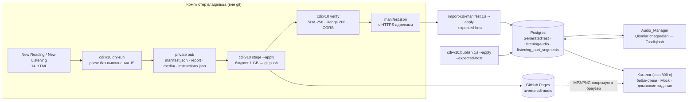
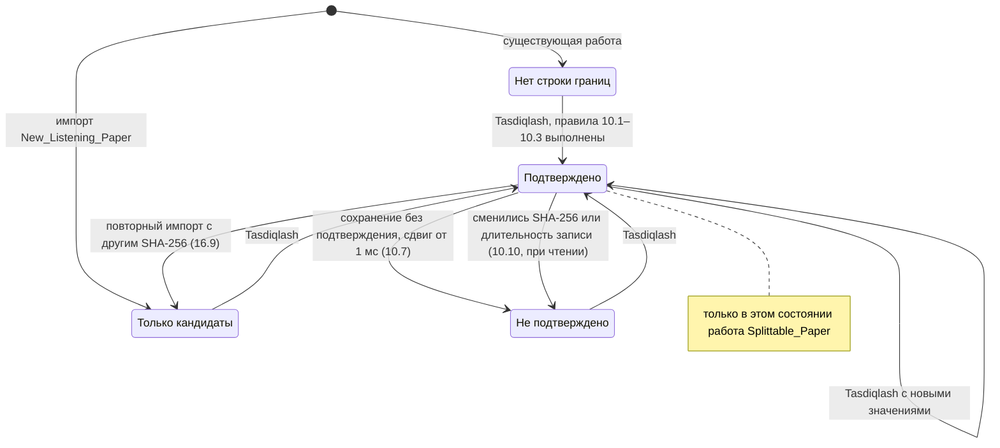
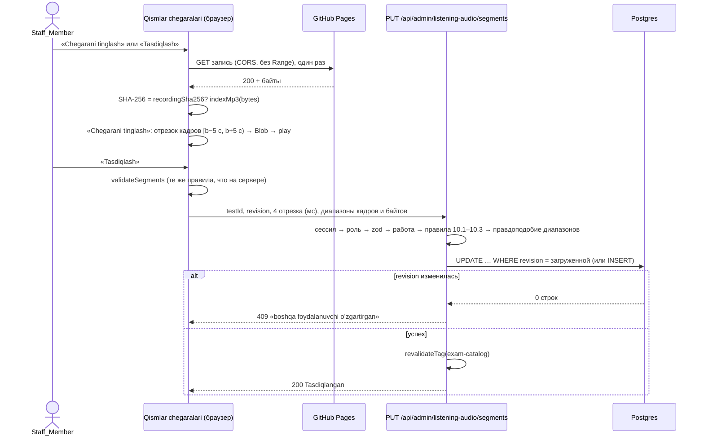
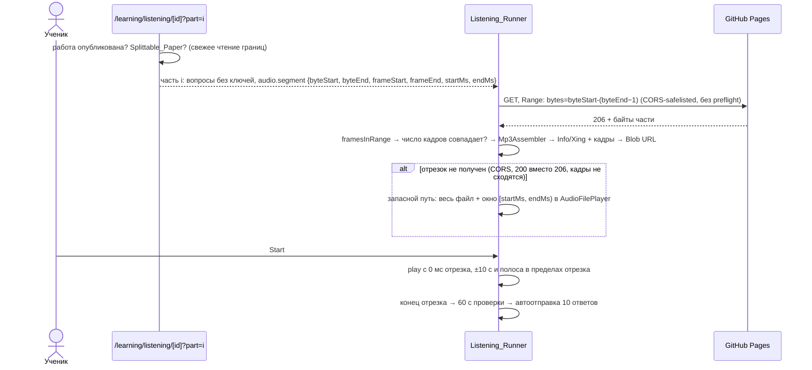

# Design Document

> Спецификация `new-tests-articles-listening-parts`. Требования: `requirements.md` (22 требования).
> Проза на русском. Заголовки разделов, идентификаторы кода, пути и формулировки свойств оставлены в формате, который требует шаблон спецификации.

## Overview

Работа состоит из трёх частей, которые почти не пересекаются в коде.

1. **Volume 10.** Офлайн-импортёр переводит 8 HTML-файлов Reading и 6 HTML-файлов Listening в `exam-v2`, извлекает MP3 и PNG без изменения байтов, проверяет ключ «40 из 40», предлагает границы частей и пишет детерминированный манифест. Файлы записей и картинок размещаются в существующем репозитории GitHub Pages `averna-cdi-audio`. Работы попадают в базу через уже существующий `scripts/import-cdi-manifest.cjs` неопубликованными, публикует их владелец отдельной командой. В приложении новые работы идут через те же каталог, раннеры, результаты, Mock и Group Mock, что и остальные работы Averna CDI.
2. **Articles в меню.** Пункт «Articles» возвращается в раздел «Skills» сразу после «Reading» (17 пунктов). Команда ⌘K «Articles» видна без запроса. Reading_Library получает ссылку на статьи. Тесты навигации меняются только в трёх местах из Requirement 8.6.
3. **Части Listening из цельной записи.** Для работ с одной записью на все 4 части появляется хранилище границ (`listening_part_segments`), блок подтверждения «Qismlar chegaralari» в Audio_Manager и режим «одна часть» в Listening_Runner. Пока Staff_Member не подтвердил все 4 границы, работа идёт только целиком, как сейчас. Одна часть играет как точный по кадрам отрезок исходного MP3: браузер скачивает Range-запросом байты своей части и оборачивает их в новый заголовок Info/Xing. Оценка части, ключ `<id>#p<N>`, «Est. band», XP, Band_Forecast, домашние задания, мини-задания, подбор практики и офлайн-пакеты переиспользуют уже существующие механизмы, которые Reading и Listening с записью на каждую часть применяют сейчас.

Что не меняется: Mock и Group Mock выдают Listening только целиком. Существующие работы, результаты, попытки, XP и задания не переписываются. Конфигурация функций Vercel остаётся по умолчанию. Код импортёра не попадает в бандл функций.

Большая часть поведения из требований уже есть в коде. Ниже это помечено как «существующее», и дизайн сводится к тому, чтобы новые работы прошли через эти пути без исключений. Новое поведение описано подробно.

### Что уже есть и переиспользуется

| Поведение | Где сейчас | Требования |
|---|---|---|
| Reading: полный тест или `?part=0…2`, 20:00 на passage, «Open this passage only» | `app/learning/reading/[testId]/page.tsx`, `reading-exam-runner.tsx`, `exam-cards.tsx` | 2.3–2.5, 2.10, 2.11 |
| Оценка части и ключ содержимого `<id>#p<N>`, идемпотентность по `submissionId` | `lib/ielts/submit.ts` (`objectiveContentKey`, `submitObjectiveExam`) | 14.1, 14.5, 14.6 |
| «Est. band» при числе вопросов ≠ 40, пояснение «x / 10 ≈ 4x / 40» | `result-hero.tsx` (`estimated = total !== 40`), `next-band.tsx` | 2.6, 14.2, 14.3 |
| Band_Forecast учитывает попытки от 10 вопросов | `lib/forecast/band-forecast.ts` (`minQuestions: 10`) | 14.4 |
| Mock: выбор «сначала нерешённые», `#pN` считается решённым, готовность записи | `lib/ielts/mock.ts` (`seenKeys`, `pickOne`), `mock-library.ts` | 3.1, 3.2, 3.6, 7.1, 7.2 |
| Group Mock: пул, вместимость, `milliseconds = durationMs + 120000` | `lib/group-mock/service.ts`, `rules.ts` | 3.4, 7.5, 7.8 |
| Цельная запись: одна строка `ListeningAudio` с `partIndex = -1`, `wholeRecordingHash`, fail-closed | `lib/ielts/audio/client.ts`, `hash.ts` | 5.6, 5.7, 6.2 |
| Время карточки Listening `ceil((D + 120000) / 60000)` | `lib/ielts/format.ts` (`summarizeListening`) | 6.1 |
| Плитка Articles в Learning Center, карточка Articles на дашборде, вкладка Skills подсвечивается на `/article` | `app/learning/page.tsx`, `daily-article.tsx`, `STUDENT_TABS` | 9.3–9.5 |

## Architecture

### Слои

| Слой | Где | Что делает | Попадает в бандл функций |
|---|---|---|---|
| Офлайн-импорт | `lib/cdi-import/**`, `scripts/cdi-v10/**`, `scripts/import-cdi-manifest.cjs`, `scripts/cdi-apply-plan.cjs` | Разбор HTML без выполнения скриптов, извлечение медиа, проверка ключа, кандидаты границ, манифест, загрузка на хостинг, запись в базу, публикация | Нет (проверяется Size_Gate и тестом импортов) |
| Общие чистые модули | `lib/ielts/segments.ts`, `lib/ielts/audio/mp3-index.ts`, `lib/ielts/parts.ts`, `lib/ielts/segments-messages.ts` | Правила границ, индекс кадров MP3, нарезка отрезка, модель карточки, выбор части, тексты ошибок на узбекском | Да, но они маленькие и без зависимостей |
| Сервер | `lib/ielts/catalog.ts`, `lib/ielts/segments-store.ts`, `lib/ielts/audio/{client,store}.ts`, `app/api/admin/listening-audio/segments/route.ts`, submit-маршруты, страницы | Каталог с состоянием «можно делить», выдача работы без ключей, сохранение границ | Да |
| Клиент | `listening-exam-runner.tsx`, `components/exam/segment-clip.ts`, `exam-cards.tsx`, `components/admin/listening-boundaries.tsx`, `save-listening-offline.tsx`, навигация | Воспроизведение части, карточки, блок границ, офлайн-сохранение | Нет (клиентские чанки) |

### Поток импорта и публикации



Байты записей и картинок идут в браузер напрямую с `*.github.io`. Функции Averna их не читают и не проксируют (Requirement 5.5, 20.4). Исключение составляет только Audio_Manager: браузер сотрудника скачивает запись целиком один раз, чтобы построить индекс кадров. Это тоже прямой запрос браузера к хостингу, без функции.

### Состояние границ работы с цельной записью



«Неподтверждено при смене записи» не требует записи в базу: строка хранит SHA-256 и длительность, для которых границы подтверждены, а `isVerified` сравнивает их с текущими значениями работы при каждом чтении.

### Подтверждение границ



### Воспроизведение одной части



## Components and Interfaces

### 1. Content_Importer

#### 1.1 Файлы и запуск

```
lib/cdi-import/               чистые модули импортёра; только относительные импорты, Node built-ins (crypto, zlib), acorn, parse5
  source-files.ts            имя файла → навык, номер, id
  payloads.ts                вырезание больших встроенных данных до разбора HTML
  dom.ts                     parse5 (только парсер, без выполнения скриптов и загрузки ресурсов) и маленькие помощники выборки
  literals.ts                acorn: литералы correctAnswers, textAnswerRules и др. без вычисления
  packed-audio.ts            utf8-seven-bit + gzip; base64 data URI
  text.ts                    текст узла, сравнение «последовательность непробельных символов»
  groups.ts                  блок «Questions N–M» → ExamGroup
  reading.ts / listening.ts  сборка ExamReadingTest / ExamListeningTest
  transcript.ts              реплики, говорящие, отметки ответов
  evidence-windows.ts        data-audio-start/end → мс
  images.ts                  PNG data URI → файл, альтернативный текст
  silence.ts                 RMS-окна → паузы
  boundaries.ts              паузы + окна ответов → кандидаты границ
  key-check.ts               ключ → ответы → Exam_Grader → «x из 40»
  guard.ts                   поиск «IELTS_Volume» и t.me в тексте работы
  instructions.ts            строки инструкций для L1_Hints (фикстура 21.4)
  manifest.ts                детерминированный JSON, пути медиа по содержимому
  report.ts                  отчёт импорта (JSON + Markdown)
  budget.ts                  решение о загрузке по бюджету 1 GB
scripts/cdi-v10/import.ts    CLI: dry-run | stage | verify
scripts/cdi-v10/publish.cjs  публикация и снятие с публикации
scripts/cdi-apply-plan.cjs   чистый план применения манифеста (используется import-cdi-manifest.cjs и тестами)
scripts/import-cdi-manifest.cjs  существующий шаг записи в базу, расширен
```

Запуск через новый npm-скрипт. Параметры компилятора лежат в отдельном `scripts/cdi-v10/tsconfig.json` (`extends: "../../tsconfig.json"`, `module: "node16"`, `moduleResolution: "node16"`), чтобы не экранировать JSON в командной строке Windows. В `package.json` нет `"type": "module"`, поэтому файлы компилируются как CommonJS и относительные импорты без расширений работают. `module: "node16"` нужен ещё и потому, что `mpg123-decoder` 1.0.3 опубликован только как ES-модуль (`"type": "module"`, типы в `types.d.ts`): при `module: "CommonJS"` TypeScript превратил бы `await import(...)` в `require(...)`, а `node16` оставляет настоящий динамический импорт.

```json
"cdi:v10": "ts-node --project scripts/cdi-v10/tsconfig.json --transpile-only scripts/cdi-v10/import.ts"
```

`ts-node` уже есть в devDependencies. Корневой `npx tsc --noEmit` по-прежнему проверяет типы этих файлов, потому что корневой `include` охватывает `**/*.ts`. Модули `lib/cdi-import/**` и их зависимости (`lib/ielts/{types,format,grading,validate,bands,sanitize}.ts`, `lib/ielts/audio/{hash,programme,voices,mp3,mp3-index}.ts`, `lib/ielts/tts.ts`) импортируются относительными путями во время выполнения, поэтому псевдоним `@/` не нужен. `lib/l1/hints.ts` использует `@/` только в `import type`, который при `--transpile-only` стирается. Тест `tests/cdi-import-guard.test.ts` проверяет, что в рантайм-импортах модулей импортёра нет `@/`, `next`, `react`, `@prisma/client`, и что ни один файл `app/**`, `components/**` и `lib/**` вне `lib/cdi-import` не импортирует `lib/cdi-import`.

Новые devDependencies с точными версиями. `acorn` и `parse5` уже лежат в `package-lock.json` как транзитивные зависимости eslint/ts-node и jsdom, поэтому их установка ничего не скачивает:

| Пакет | Версия | Зачем |
|---|---|---|
| `acorn` | `8.17.0` | Разбор скриптов источника в AST и чтение литералов без выполнения. Типы в пакете |
| `parse5` | `7.3.0` | Разбор HTML в дерево. Это только парсер: скриптов он не выполняет и ресурсов не загружает. Типы в пакете. `jsdom` не подходит для `tsc --noEmit`: у него нет типов, а `@types/jsdom` пришлось бы добавлять отдельно |
| `mpg123-decoder` | `1.0.3` (MIT, зависимость `@wasm-audio-decoders/common` `9.0.7`) | Декодирование MP3 в PCM по частям для поиска пауз ниже −40 dBFS (Requirement 10.4). Работает в Node через WASM, без нативной сборки. Пакет только ESM, типы в пакете. Импортируется динамически (`await import("mpg123-decoder")`) только из `pausesFromMp3` |

Новых runtime-зависимостей нет. Пакеты из таблицы импортируются только модулями `lib/cdi-import/**` и `scripts/cdi-v10/**`, поэтому в трассировку функций Next они не попадают (проверяет Size_Gate).

#### 1.2 Команды

| Команда | Что делает | Пишет в базу | Загружает |
|---|---|---|---|
| `npm run cdi:v10 -- dry-run --reading <dir> --listening <dir> --out <dir> --media-base <https URL>` | Разбор 14 файлов, проверки, кандидаты границ, медиа в `out/media`, `manifest.json` с заглушками `cdi-asset://<path>`, `report.json` и `report.md`, `instructions.json`. Без доступа к базе и сети | Нет | Нет |
| `npm run cdi:v10 -- stage --out <dir> --pages-repo <локальная копия averna-cdi-audio> --apply --expected-upload-host <owner>.github.io` | Проверка хоста и бюджета, копирование новых файлов в клон, `git commit`, `git push` | Нет | Да |
| `npm run cdi:v10 -- verify --out <dir>` | Скачивает каждый файл по HTTPS, сравнивает SHA-256, проверяет Range 206 и `Access-Control-Allow-Origin`, заменяет `cdi-asset://` на адреса, пересчитывает `wholeRecordingHash` и `contentSha256`, повторно проверяет работы | Нет | Нет |
| `node scripts/import-cdi-manifest.cjs <out>/manifest.json [--apply --expected-host=<db host>]` | Существующий шаг, расширенный: предварительная проверка конфликтов, проверка схемы, кандидаты границ | Только с `--apply` | Нет |
| `node scripts/cdi-v10/publish.cjs --ids=<id,…> [--unpublish] [--apply --expected-host=<db host>]` | Публикация или снятие перечисленных работ | Только с `--apply` | Нет |

Без `--apply` каждая команда работает как пробный запуск (Requirement 17.1). `--out` обязан лежать вне корня репозитория: импортёр сравнивает `path.resolve(out)` с корнем и останавливается, если каталог внутри него (Requirement 17.7). Ошибки подключения выводятся без строки подключения (существующее поведение `import-cdi-manifest.cjs`).

#### 1.3 Разбор источника без выполнения скриптов

1. `payloads.ts` находит строкой, без регулярных выражений по всему файлу: `<script id="embeddedAudioData" …>…</script>`, атрибуты `src="data:audio/mpeg;base64,…"` и `src="data:image/png;base64,…"`. Содержимое заменяется ссылкой `cdi-payload://<n>`, сами данные сохраняются в памяти как строки. После этого HTML весит около 1 MB.
2. `dom.ts` разбирает HTML через `parse5.parse(html)`. Помощники `select(root, { tag, cls, attr })`, `attr(node, name)` и `textContent(node, { skip })` обходят дерево. Сущности HTML parse5 декодирует сам. Текст `<script>` остаётся строкой и нигде не выполняется: в модулях импортёра нет `eval`, `new Function`, `vm` и `child_process` (проверяет `tests/cdi-import-guard.test.ts`). Отдельный тест разбирает фикстуру со скриптом, у которого есть побочный эффект (`globalThis.__executed = true`), и проверяет, что флаг не появился.
3. `literals.ts` разбирает текст каждого `<script>` через `acorn.parse(code, { ecmaVersion: "latest" })` и обходит AST. Для нужных имён (`correctAnswers`, `textAnswerRules`, `ddOptions`, `headingOptions`, `people`, `dates`, `endings`, `stems`, `sections`, `paragraphs*`, `pickTwoGroups`, `multiPickGroups`, `listeningMatchAssignments` и других, найденных в файлах) берётся инициализатор `VariableDeclarator`. Допускаются только `ObjectExpression`, `ArrayExpression`, `Literal`, `TemplateLiteral` без выражений и унарный минус перед числом. Любой другой узел даёт ошибку «non-literal», значение не вычисляется. При осмотре все 14 файлов разобрались этим способом: ключи Reading записаны в одинарных кавычках, ключи Listening 3–6 в стиле JSON.

```ts
export type Literal = string | number | boolean | null | Literal[] | { [k: string]: Literal };
export class LiteralError extends Error { constructor(readonly name: string, readonly nodeType: string) }
export function extractLiterals(scripts: readonly string[], names: readonly string[]): Record<string, Literal>;
```

#### 1.4 Reading

```ts
export type HtmlDocument = import("parse5").DefaultTreeAdapterMap["document"];
export interface SourceMeta { file: string; sha256: string; id: string; number: number; skill: "READING" | "LISTENING" }
export interface ConvertIssue { file: string; questions?: number[]; part?: number; message: string }
export interface ConvertResult<T> { paper: T | null; warnings: ConvertIssue[]; errors: ConvertIssue[] }
export function identifySource(fileName: string): Pick<SourceMeta, "skill" | "number" | "id"> | null;
export function convertReading(doc: HtmlDocument, literals: Record<string, Literal>, meta: SourceMeta): ConvertResult<ExamReadingTest>;
```

- `identifySource`: навык из слова `reading`/`listening`, номер из `test\s*(\d+)`, без учёта регистра. `vol 10 test 7 reading.html` → `cdi-v10-reading-07`. Порядок файлов в папке на результат не влияет: после разбора работы сортируются по id (Requirement 16.3).
- Работа: `format: "exam-v2"`, `skill: "READING"`, `id`, `title: "Volume 10 · Reading Test N"`, `description: "Averna CDI · Academic Reading"` (валидатор требует непустое описание, а в источнике его нет), `difficulty: "Medium"`, `timeLimit: 60`, `source: "imported"`, `imported: { provider: "user-supplied-cdi", file, sha256, importVersion: 2 }`, 3 части.
- Passage: заголовок и абзацы из `.part-content[data-part]`. Метка абзаца берётся из элемента `.letter` источника как есть (A–I, а в тесте 5 цифры 1–7 и буквы A–G). Текст абзаца равен `textContent` без метки. Разметка выделений источника не переносится.
- Группа: блок `.question-group` с заголовком «Questions N–M» и `.instruction`. Тип выбирается по таблице. Если ни одна строка не подходит, это ошибка (1.11).

| Признак в блоке | Тип |
|---|---|
| Варианты TRUE / FALSE / NOT GIVEN | `tfng` |
| Варианты YES / NO / NOT GIVEN | `ynng` |
| Радиокнопки с вариантами A–D у каждого вопроса | `mcq` |
| «Choose TWO/THREE letters», `.multi-choice-option` | `mcq-multi` |
| `.matching-grid`, список абзацев, заголовков (i–x), людей, дат или окончаний | `matching` |
| `.dd-summary-card` с банком слов | `gap-box` |
| `.answer-input` / `.inline-answer` / `.notes-card` без банка | `gap` |

- Перенос полей группы (1.12): `instructions` = текст `.instruction`; `wordLimit` и `allowNumber` из фразы лимита («NO MORE THAN TWO WORDS AND/OR A NUMBER») и атрибута `data-maxwords`; `answerRule` = исходная фраза правила, чтобы текст совпадал с источником, а не с `answerRuleFor`; `options` с ключами источника (буквы, римские цифры); `allowReuse` при «You may use any letter more than once».
- Пропуски `gap`/`gap-box` записываются как `[[n]]` в `template` (заметки, summary) или в `text` вопроса (предложения).
- Ключ (1.5): все альтернативы `correctAnswers[n]` в исходном порядке попадают в `answer`. Для `mcq-multi` буквы всех номеров группы объединяются, сортируются и записываются одним набором в каждый вопрос группы. Набор, размер которого не равен числу вопросов группы, даёт ошибку.
- Несовпадение объявленного диапазона букв и фактических вариантов (тест 2, «A–J» без I) не исправляется. В отчёт пишется предупреждение с файлом и номерами вопросов (1.9). Валидатор в этом случае даёт только предупреждение `option keys are not sequential`.
- Объяснения не создаются (1.2).
- Работа проходит `validateReadingTest(paper, { requireFull: true })`. Ошибки проверки исключают её из манифеста (1.10). Предупреждения «no explanation» ожидаемы и в отчёте сворачиваются в одну строку.

#### 1.5 Listening

```ts
export interface ExtractedAudio { bytes: Uint8Array; sha256: string; index: Mp3Index }
export function convertListening(doc: HtmlDocument, literals: Record<string, Literal>, meta: SourceMeta, audio: ExtractedAudio): ConvertResult<ExamListeningTest>;
```

- Работа: `title: "Volume 10 · Listening Test N"`, `description: "Averna CDI · Listening"`, `difficulty: "Medium"`, `source: "imported"`, `recordingMode: "whole"`, `recordingDurationMs` и `recordingSha256` из `ExtractedAudio`, `imported` как у Reading, 4 части Part 1 … Part 4 с вопросами 1–10, 11–20, 21–30, 31–40. Тема части из заголовка раздела источника (например, «Volunteering at Mountain Festival») записывается в `title` части: карточка, Homework_Library и мини-задание уже показывают `title`, если он не пустой и не вида «Part N» (12.1). Номер «Part N» интерфейс берёт из порядка частей. `context` обязателен для валидатора, а другого описания в источнике нет, поэтому в `context` записывается та же тема.
- Группы: те же типы, что в Reading. Лимиты в тестах 3–6 берутся из `textAnswerRules` (`maxWords` → `wordLimit`, `maxNumbers > 0` → `allowNumber`). В тестах 1–2 лимиты берутся из текста инструкции. Если `textAnswerRules` расходится с текстом инструкции, сохраняется источник и пишется предупреждение (4.12).
- Транскрипт (4.5): разделы `[data-part]` (тест 1) или `[data-section]` (тесты 2–6) дают 4 части. Реплика соответствует абзацу (`.transcript-paragraph` или `p`), говорящий берётся из `.speaker`/`strong.speaker`, текст реплики равен `textContent` без говорящего, без `sup.transcript-q-tag` и без отметки `[Qn → …]`. `<mark data-questions="13 14">` и `[Qn → …]` превращаются в `ScriptLine.marks` со смещениями фрагмента в тексте реплики. Для `<mark>` фрагментом служит текст самого элемента. Для `[Qn → x]` (тест 1) фрагментом служит ближайшее предшествующее вхождение `x` в той же реплике (сравнение через `normalizeAnswer`), а если его нет, предложение, в котором стоит отметка. Если у вопроса нет отметки в транскрипте, пишется предупреждение.
- Говорящие: `speakers: []`. Имена в репликах остаются подписями из источника. Пол и акцент не выдумываются (см. «Решения», п. 12).
- Окна ответов (4.6, 4.13): кнопки `.audio-evidence-button[data-questions][data-audio-start][data-audio-end]` дают `evidenceWindows[n] = { startMs: round(s × 1000), endMs: round(e × 1000) }` для каждого номера из `data-questions`. Окно с `start < 0`, `start ≥ end` или `end > recordingDurationMs` отбрасывается с предупреждением.
- Картинки (4.7): `src="data:image/png;base64,…"` внутри группы декодируется и сохраняется как PNG (проверяется сигнатура PNG из 8 байт). В манифесте dry-run URL записан как `cdi-asset://v10/<id>-q<from>-<to>-<sha16>.png`: существующий шаг записи в базу отказывает таким манифестам, пока `verify` не подтвердил загрузку. Альтернативный текст описан в «Решениях», п. 13.
- Работа проходит `validateListeningTest(paper, { requireFull: true })` (4.10). Валидатор требует у картинок `https://`, поэтому на этапе dry-run проверяется копия работы, где `cdi-asset://<path>` заменён будущим адресом `<media-base><path>`. Адреса зависят только от содержимого, поэтому после `verify` они совпадают с проверенными.

Изменение `lib/ielts/validate.ts` (единственное послабление): для `suppliedRecording` подпись говорящего в реплике не обязана быть в `speakers`, а `speakers` может быть пустым. Для работ без цельной записи проверки не меняются. Существующие работы проходят проверку так же, как раньше, потому что правило только расширяется.

#### 1.6 Записи

```ts
// lib/cdi-import/packed-audio.ts
export function decodeBase64DataUri(uri: string): Uint8Array;                 // ошибка, если не base64
export function decodeUtf8SevenBit(text: string, length: number): Uint8Array; // алгоритм источника: группы по 7 бит, экранирование 0/13/60
export function encodeUtf8SevenBit(bytes: Uint8Array): string;                // обратная функция, для фикстур и проверки
export function unpackEmbeddedAudio(p: { text: string; compressedBytes: number; originalBytes: number }): Uint8Array; // gunzipSync + проверка длины
```

```ts
// lib/ielts/audio/mp3-index.ts (общий модуль: импортёр, Audio_Manager, раннер)
export interface Mp3Index {
  format: Mp3Format;            // из mp3.ts
  firstFrameOffset: number;     // после ID3v2 и кадра Xing/Info/VBRI/LAME
  offsets: Uint32Array;         // начало каждого звукового кадра; offsets[frames] = конец последнего кадра
  frames: number;
  frameMs: number;              // samplesPerFrame × 1000 / sampleRate
  durationMs: number;           // round(frames × samplesPerFrame × 1000 / sampleRate)
  junkBytes: number;
}
export function indexMp3(bytes: Uint8Array): Mp3Index;                         // Mp3Error, если кадров нет
export function framesInRange(bytes: Uint8Array, format: Mp3Format): Uint8Array[]; // кадры отрезка, без отбрасывания «ведущих» кадров
export function buildClip(bytes: Uint8Array, expectedFrames: number, format: Mp3Format): Uint8Array | null; // Info/Xing + кадры или null
```

`indexMp3` повторяет правила `parseMp3` из `mp3.ts` (синхронизация по двум заголовкам подряд, ID3v2 в начале, ID3v1/APE в конце), но в отличие от `parseMp3` не отбрасывает первые кадры, которые берут данные из bit reservoir. Поэтому `durationMs` равна сумме длительностей всех звуковых кадров (Requirement 5.3). Кадр-заголовок Xing/Info/VBRI/LAME не считается звуковым, как и в плеерах. Ожидаемые длительности 25:59, 27:13, 29:54, 25:21, 28:24 и 25:29 проверяются в отчёте с допуском ±1 с.

Ошибки 5.2 (не base64, не распаковывается, длина ≠ `data-original-bytes`, нет кадров) исключают работу, её медиа не попадают в `out/media`, импорт остальных файлов продолжается.

#### 1.7 Кандидаты границ

```ts
// lib/cdi-import/silence.ts
export const WINDOW_MS = 50, SILENCE_DBFS = -40, MIN_PAUSE_MS = 1000;
export interface Pause { startMs: number; endMs: number }
export function rmsDbfs(samples: Float32Array[]): number;                  // по всем каналам окна
export function detectPauses(windowsDb: Float32Array, windowMs?: number, thresholdDb?: number, minMs?: number): Pause[];
export async function pausesFromMp3(bytes: Uint8Array, index: Mp3Index): Promise<Pause[]>; // mpg123-decoder, кусками по ~2 с, PCM не хранится целиком

// lib/cdi-import/boundaries.ts
export interface BoundaryCandidate { boundary: 1 | 2 | 3; ms: number; method: "pause" | "evidence" }
export function admissibleInterval(k: 1 | 2 | 3, ctx: { durationMs: number; windowsByPart: Window[][] | null }): { from: number; to: number } | null;
export function proposeBoundaries(ctx: { durationMs: number; pauses: Pause[]; windowsByPart: Window[][] | null }): (BoundaryCandidate | null)[];
```

- Пауза — непрерывная серия 50-мс окон с RMS ниже −40 dBFS длиной не меньше 1000 мс.
- Допустимый интервал границы k между частями k и k+1. В тестах 3–6 он начинается на самом позднем `endMs` окон части k и заканчивается на самом раннем `startMs` окон части k+1 (10.4). В тестах 1–2 окон нет, поэтому интервал равен `[k·D/4 − D/8, k·D/4 + D/8]` (см. «Решения», п. 16). Интервал дополнительно сужается так, чтобы каждая часть была не короче 120 000 мс.
- Выбор паузы: самая ранняя пауза в интервале длиной не меньше 10 с, а если такой нет, самая длинная пауза в интервале не короче 1 с. Кандидат ставится в `max(pause.startMs, pause.endMs − 500)`, то есть внутри паузы и за полсекунды до следующей речи («Now turn to Part 2»).
- Если паузы в интервале нет, а окна есть (тесты 3–6), кандидат ставится в середину интервала с методом «evidence».
- Если интервал пуст, длительность меньше 480 000 мс или кандидата нет, граница остаётся пустой, в отчёт пишется предупреждение с номером границы, работа импортируется как «только целиком» (10.11).
- Если все три кандидата есть, построенные по ним 4 отрезка проходят `validateSegments` (10.4, последнее предложение). Иначе все три кандидата отбрасываются с предупреждением.

#### 1.8 Медиа и Recording_Host

- Пути по содержимому: `v10/<id>-<sha256[0:16]>.mp3` и `v10/<id>-q<from>-<to>-<sha256[0:16]>.png`. Один и тот же файл всегда получает один и тот же адрес, поэтому повторный запуск даёт тот же манифест, а уже размещённый файл повторно не загружается (5.10).
- `stage`:
  1. `--expected-upload-host` должен точно совпадать с `new URL(mediaBase).hostname`, а `git remote get-url origin` клона должен указывать на `github.com/<owner>/averna-cdi-audio`, где `<owner>` равен первой части хоста `<owner>.github.io`. При несовпадении команда останавливается до первой записи (17.2).
  2. Бюджет (20.7): занятый объём равен сумме размеров файлов из `git -C <clone> ls-tree -r -l origin/<branch>` после `git fetch`. Объём новых файлов равен сумме файлов `out/media`, которых ещё нет в дереве с тем же SHA-256. Если сумма больше 1 073 741 824 байт или команда `git` завершилась ошибкой, загрузка не начинается, а в отчёт пишутся занятый объём, новый объём и лимит.
  3. Новые файлы копируются в клон, затем `git add <файлы>`, `git commit -m "Volume 10 media"`, `git push`.
- `verify` (5.4, 5.9, 5.11) для каждого файла: `GET` целиком → SHA-256 совпадает; `GET` с `Range: bytes=0-99` → статус 206 и ровно 100 байт; заголовок `Access-Control-Allow-Origin` равен `*` или производственному адресу Averna. Пока GitHub Pages разворачивает сайт, команда повторяет проверку раз в 30 с, не дольше 15 минут. Файл, не прошедший проверку, исключает свою работу из манифеста.

```ts
// lib/cdi-import/budget.ts
export const HOST_BUDGET_BYTES = 1024 ** 3;
export type BudgetDecision = { ok: true } | { ok: false; usedBytes: number | null; newBytes: number; limitBytes: number };
export function budgetDecision(usedBytes: number | null, newBytes: number, limit?: number): BudgetDecision;
```

#### 1.9 Проверка ключа и прочие проверки dry-run

```ts
export type KeyPick = "first" | "last";
export function answersFromKey(test: ExamTest, key: Record<string, Literal>, pick: KeyPick): ExamAnswers;
export function checkKey(test: ExamTest, key: Record<string, Literal>): { first: GradeResult; last: GradeResult; missed: number[] };
export function findBannedReferences(test: ExamTest): { where: string }[]; // «IELTS_Volume» без учёта регистра, t.me
export function instructionLines(test: ExamTest): string[];              // инструкция, правило ответа, «Questions N–M»
```

- `checkKey` строит ответы из исходного литерала `correctAnswers`, а не из перенесённого `answer`, и оценивает их через `gradeTest` (Exam_Grader). Для `mcq-multi` буквы группы кладутся в первый номер группы в обратном порядке, чтобы проверить «в любом порядке». Работа с результатом меньше 40 из 40 в любом из двух вариантов исключается, в отчёт пишутся незасчитанные номера (4.4, 22.2, 22.5).
- `findBannedReferences` проходит все тексты работы. Совпадение исключает работу (18.7). Элементы интерфейса источника (таймер, заметки, переключатель темы, кнопки) не переносятся, потому что конвертер читает только перечисленные выше селекторы (18.5).
- В отчёт записывается число элементов содержимого вопросов, для которых `l1Hint(..., "uz" | "ru")` вернул не `null` (заголовок группы, общий вариант, текст вопроса с `____` вместо пропуска, вариант вопроса). Ожидается 0 (21.3). Ненулевое число даёт ошибку отчёта, и до выпуска правила в `hints.ts` правятся.
- `instructions.json` содержит для каждого id навык и строки `instructionLines` (21.4). Ключей, вариантов, текстов вопросов, passage и транскриптов в нём нет. Файл копируется в репозиторий как `tests/fixtures/cdi-v10-instructions.json`.

#### 1.10 Запись в базу (`import-cdi-manifest.cjs`)

Существующие проверки манифеста остаются: `version: 1`, уникальные `cdi-*`, `validated`, `contentSha256`, отсутствие `cdi-asset://`, у Listening `audio.partIndex === -1` и HTTPS. Добавляется следующее.

```js
// scripts/cdi-apply-plan.cjs
/** @returns {{ ok: true, steps: Step[] } | { ok: false, conflicts: { id: string, reason: string }[] }} */
function planApply(items, existingRows, existingSegments) {}
/** @returns {{ candidates, segments, verifiedAt, verifiedById, revision, recordingSha256, durationMs, warning?: string }} */
function nextSegmentsRow(existing, item) {}
module.exports = { planApply, nextSegmentsRow, REQUIRED_SCHEMA };
```

1. Проверка схемы (20.6): до первой записи `SELECT table_name, column_name FROM information_schema.columns WHERE table_name = 'listening_part_segments'`. Недостающие столбцы перечисляются, команда завершается с кодом 1.
2. Предварительная проверка всех id (16.4): строка с тем же id допустима только если она не опубликована, `data.imported.provider === "user-supplied-cdi"`, `module` совпадает и `data.imported.file` совпадает с файлом элемента манифеста. Любой конфликт останавливает команду до первой записи: выводится конфликтующий id, код выхода 1.
3. Для каждой работы одна транзакция: `GeneratedTest` (неопубликованный), строка `ListeningAudio` `partIndex = -1` и строка `listening_part_segments` (17.3, 17.9). При ошибке оставшиеся работы не применяются, выводятся списки применённых и неприменённых id.
4. `nextSegmentsRow` (16.8, 16.9): строки нет → создаётся с кандидатами, `segments = null`. Тот же SHA-256 и та же длительность → обновляются только `candidates`, а `segments`, `verifiedAt`, `verifiedById` не меняются. Другой SHA-256 или длительность → `segments = null`, `verifiedAt = null`, `verifiedById = null`, новые `recordingSha256`, `durationMs`, `candidates`, `revision + 1` и предупреждение с id работы.

#### 1.11 Публикация (`scripts/cdi-v10/publish.cjs`)

- Те же проверки хоста, что у импортёра (`--expected-host` = `new URL(DATABASE_URL).hostname`), пробный запуск по умолчанию.
- Для каждого id из `--ids`: строка существует, `module` READING или LISTENING, `data.imported.provider === "user-supplied-cdi"`. Для Listening при публикации дополнительно нужна строка `ListeningAudio` (`partIndex = -1`, `status = "ready"`, HTTPS, `durationMs > 0`). Работа, не прошедшая проверку, не меняется, а её id выводится в списке отказов.
- `updateMany({ where: { id: { in: ok } }, data: { published } })`. Работа, её запись и границы при снятии с публикации остаются в базе (17.5). Каталог обновляется не позже чем через 300 с (`REVALIDATE_SECONDS`).

### 2. Общие модули границ и частей

```ts
// lib/ielts/segments.ts — чистый, клиент и сервер
export const MIN_PART_MS = 120_000;
export const MIN_SPLIT_DURATION_MS = 480_000;
export interface PartSegment { startMs: number; endMs: number }
export interface SegmentRange { frameStart: number; frameEnd: number; byteStart: number; byteEnd: number }
export interface StoredSegments { v: 1; sampleRate: number; samplesPerFrame: number; parts: (PartSegment & SegmentRange)[] }
export interface Window { startMs: number; endMs: number }
export type SegmentRule = "partition" | "min-length" | "evidence";
export interface SegmentViolation { rule: SegmentRule; part: 1 | 2 | 3 | 4 }
export interface SegmentRecordLike {
  recordingSha256: string; durationMs: number; segments: StoredSegments | null;
  verifiedAt: Date | string | null; verifiedById: string | null; revision: number;
}
export interface SegmentSaveInput {
  revision: number; confirm: boolean; actorId: string;
  segments: PartSegment[]; ranges: SegmentRange[]; sampleRate: number; samplesPerFrame: number; fileSha256: string;
  /** Текущая запись работы и её окна ответов: правила проверяются относительно них. */
  recording: { sha256: string; durationMs: number; bytes: number }; windowsByPart: Window[][];
}
export type SegmentSaveOutcome =
  | { ok: true; next: SegmentRecordLike; verified: boolean }
  | { ok: false; reason: "conflict" }
  | { ok: false; reason: "invalid"; violation: SegmentViolation }
  | { ok: false; reason: "recording" };

export function segmentsFromBoundaries(boundaries: readonly [number, number, number], durationMs: number): PartSegment[];
export function validateSegments(segments: readonly PartSegment[], ctx: { durationMs: number; windowsByPart: readonly Window[][] }): SegmentViolation | null;
export function windowsByPart(test: Pick<ExamListeningTest, "parts" | "evidenceWindows">): Window[][];
export function segmentRanges(index: Pick<Mp3Index, "offsets" | "frames" | "frameMs">, segments: readonly PartSegment[]): SegmentRange[];
export function checkRanges(stored: StoredSegments, ctx: { bytes: number; durationMs: number }): boolean;   // правдоподобие на сервере
export function isVerified(record: SegmentRecordLike | null, test: Pick<ExamListeningTest, "recordingSha256" | "recordingDurationMs" | "parts" | "evidenceWindows">): boolean;
export function applySegmentSave(prev: SegmentRecordLike | null, input: SegmentSaveInput, now: Date): SegmentSaveOutcome;
export function boundaryValues(record: SegmentRecordLike | null, candidates: (BoundaryCandidate | null)[] | null, durationMs: number):
  { source: "saved" | "candidates" | "empty"; boundaries: [number | null, number | null, number | null]; verified: boolean }; // для блока границ (11.1)
export function resumeInSegment(savedMs: number | null, lengthMs: number): number; // позиция продолжения внутри отрезка (13.5)
export function partPracticeMinutes(segment: PartSegment): number;    // ceil(длина / 60000) + 1
export function parseClock(text: string): number | null;              // "06:42.3" → 402300; иначе null
export function formatClock(ms: number): string;                      // 402300 → "06:42.3"
```

- `validateSegments` возвращает первое нарушение в порядке «разбиение» → «минимальная длина» → «окна ответов», с номером части (10.9, 11.5). Разбиение: ровно 4 отрезка, целые мс, первый начинается в 0, начало N+1 равно концу N, последний кончается на `durationMs`, каждый конец больше начала. Минимальная длина: `endMs − startMs ≥ 120000` (ровно 120000 допустимо). Окна: для каждого окна вопроса части N `start(N) ≤ window.startMs` и `window.endMs ≤ end(N)`.
- `segmentRanges`: граница b переводится в кадр `round(b / frameMs)`, начало части 1 равно кадру 0, конец части 4 равен `frames`. Байты: `byteStart = offsets[frameStart]`, `byteEnd = offsets[frameEnd]`. Отрезки смежные по построению, а длительность отрезка кадров отличается от длины Part_Segment не больше чем на один кадр (24–26,1 мс).
- `isVerified` = запись есть, `verifiedAt` не пуст, `recordingSha256` и `durationMs` записи совпадают с работой, `segments` проходят `validateSegments` и `checkRanges`. Повторная проверка при чтении защищает от устаревших данных после смены окон или длительности (10.5, 10.10).
- `applySegmentSave(prev, { segments, ranges, confirm, revision, actorId })`: неверная ревизия → `conflict`; нарушение правил → `invalid` с нарушением; `confirm: true` → сохранить и подтвердить (`verifiedAt = now`, `verifiedById = actorId`); `confirm: false` → сохранить, а если хотя бы одна внутренняя граница отличается от подтверждённой хотя бы на 1 мс, снять подтверждение (10.7). Audio_Manager всегда отправляет `confirm: true`. Вариант `confirm: false` есть в API и в доменной функции ради 10.7, кнопки для него нет (11.3).

```ts
// lib/ielts/parts.ts — чистый
export function canPractiseParts(s: Pick<ExamTestSummary, "partInfo" | "recordingMode" | "splittable">): boolean;
export function resolvePracticePart(test: { parts: unknown[] }, raw: unknown, splittable: boolean): number | null;
export interface ListeningCardRow { n: number; title: string; detail: string; href?: string }
export interface ListeningCardModel { label: string; rows: ListeningCardRow[]; note: string | null; cta: { href: string; label: string } }
export function listeningCardModel(s: ExamTestSummary): ListeningCardModel;
export function listeningPartMinutes(s: ExamTestSummary, part: number): number;
```

- `canPractiseParts`: больше одной части и (`recordingMode !== "whole"` или `splittable === true`). Для работ с записью на каждую часть правило совпадает с нынешним.
- `resolvePracticePart` = `resolvePartIndex` (целое от 0 до числа частей − 1), но для цельной записи без подтверждения возвращает `null`. Значения `part=3` для Reading, `part=-1`, `part=abc` дают `null`, то есть полный тест без сообщения (2.4, 13.7).
- `listeningCardModel` описан в разделе 4.

### 3. Каталог и сервер

```ts
// lib/ielts/segments-store.ts — SERVER ONLY
export interface SegmentRecord extends SegmentRecordLike { testId: string; candidates: (BoundaryCandidate | null)[] | null; revision: number; updatedAt: Date }
export async function loadSegmentRecords(testIds: string[]): Promise<Map<string, SegmentRecord>>; // пустая Map, если таблицы нет
export async function getVerifiedSegments(test: ExamListeningTest): Promise<StoredSegments | null>;  // свежее чтение, без кэша
export async function saveSegments(input: SegmentSaveInput & { testId: string }): Promise<SegmentSaveOutcome>;
```

Изменения `lib/ielts/catalog.ts`:

- `cachedListeningSummaries`: после разбора строк одним запросом читает `listening_part_segments` для работ с цельной записью и добавляет в сводку `splittable` и `partInfo[i].durationMs` (длина подтверждённого отрезка). Ошибка этого запроса (например, `deploy.sql` ещё не применён) даёт «не подтверждено», а не ошибку каталога (20.5). Ключ кэша меняется на `exam-catalog-listening-cdi-v4-segments`, тег прежний. Сортировка `order` не меняется (2.2).
- `getReadingExamForAttempt(id)` и `getListeningExamForAttempt(id)`: как `get*Exam`, но без условия `published`. Используются только там, где у пользователя уже есть попытка с этой работой: страницы результатов (17.6) и секции уже начатого Mock (3.8, 17.10). Выбор работ для новых попыток, библиотеки и прямые ссылки продолжают использовать опубликованные работы (2.9, 17.5, 17.8).

Изменения `lib/ielts/sanitize.ts` (2.8, 6.6): `toClientListening` убирает `evidenceWindows` с уровня работы и `marks` из каждой реплики. `toClientGroup` по-прежнему убирает `answer` и `explanation`. Тест проверяет, что в JSON клиентской работы нет `answer`, `explanation`, `evidenceWindows`, `marks`, а у работ с записью нет строк транскрипта.

Изменения `lib/ielts/audio/client.ts`: новая опция `listeningClientContent(test, { segmentPart: { index, segments } })`. Если цельная запись готова (те же проверки, что сейчас), часть `index` получает

```ts
audio: { url: fullRecording.url, durationMs: seg.endMs - seg.startMs, timeline: [],
         segment: { startMs, endMs, byteStart, byteEnd, frameStart, frameEnd, sampleRate, samplesPerFrame, sourceDurationMs } }
```

а `fullRecording` в ответ не кладётся, чтобы раннер не включил режим целой записи. Остальные части отдаются без вопросов, как в существующем режиме одной части (раннер берёт `test.parts[partIndex]`).

Страница `app/learning/listening/[testId]/page.tsx`: для цельной записи `part = resolvePracticePart(test, searchParams.part, !!segments)`, где `segments = await getVerifiedSegments(test)`. Домашнее задание проверяется с тем же `part`.

Маршрут `app/api/learning/listening/submit/route.ts` (14.7): если работа с цельной записью, `body.part` задан и `getVerifiedSegments(exam)` вернул `null`, ответ `409 { error: "Separate parts of this test are no longer available. Take the full test instead.", code: "part_unavailable" }`. Результат не сохраняется, XP не начисляется, прогноз не меняется. Сейчас маршрут принимает часть и для цельных записей, это исправляется.

### 4. Listening_Library и Listening_Runner

`ListeningExamCard` строится из `listeningCardModel(summary)`:

| Работа | Подпись раздела | Строки | Примечание |
|---|---|---|---|
| Запись на каждую часть, больше одной части (как сейчас) | «Parts · practise one at a time» | «Practise Part N», тема, диапазон, «~N min», ссылка `?part=N−1` | нет |
| Цельная запись с Verified_Segments | «Parts · practise one at a time» | «Practise Part N», тема из `title` части (пусто или «Part N» не показывается), «Questions 11–20», `${ceil(len/60000)+1} min`, ссылка `?part=N−1` | нет |
| Цельная запись без Verified_Segments | «One complete recording · Parts 1–4» | «Part N», тема, диапазон, без ссылки и без длительности | «Original, uncut audio. Separate part playback is unavailable until recording boundaries are verified.» |

Кнопка «Start full test» ведёт на `/learning/listening/<id>` без `part` у любой полной работы (12.2). Время на карточке не меняется: `ceil((D + 120000) / 60000)` (6.1).

Listening_Runner:

- `practicePart` разрешается и для `suppliedWhole`, если у выбранной части есть `audio.segment`. Остальная логика одной части уже есть: заголовок «Listening practice · Part N», только вопросы части, проверка 60 с с обратным отсчётом и кнопкой досрочной отправки, автоотправка, сохранение ответов и позиции под `averna-exam-audio:<attemptId>` (13.1, 13.4–13.6, 13.8, 13.9).
- Новый модуль `components/exam/segment-clip.ts`:

```ts
export type SegmentAudio = ListeningPartAudio & { segment?: ClientSegment };
export type PlayableSegment =
  | { mode: "clip"; url: string /* blob: */; durationMs: number; bytes: Blob }
  | { mode: "window"; url: string; durationMs: number; window: PartSegment };
export function loadSegmentClip(seg: ClientSegment & { url: string }, opts: { signal: AbortSignal; onProgress?: (loaded: number, total: number) => void }): Promise<PlayableSegment>;
```

  `loadSegmentClip` выполняет `fetch(url, { mode: "cors", credentials: "omit", headers: { Range: "bytes=<byteStart>-<byteEnd − 1>" } })`. Это CORS-safelisted запрос без preflight, а GitHub Pages на OPTIONS отвечает 405 (проверено). Нужен ответ 206 длиной ровно `byteEnd − byteStart`. Ответ 200 означает, что хост проигнорировал Range, и загрузка прерывается, чтобы не качать весь файл. Затем `buildClip(bytes, frameEnd − frameStart, format)` и `URL.createObjectURL(new Blob([clip], { type: "audio/mpeg" }))`. При любой ошибке возвращается `mode: "window"`: весь файл и окно отрезка.
- `AudioFilePlayer` получает опцию `window?: PartSegment`. С ней все позиции API (`startMs`, `seek`, `snapshot.positionMs`, `durationMs`, `endAtMs`) отсчитываются от начала окна, а `clamp` ограничивает позицию отрезком `[0, длина окна − 250]`. Без опции поведение прежнее. Так ±10 с, перетаскивание полосы и «повтор части» никогда не выходят за отрезок, а счётчик идёт от 00:00 до длины части (13.3).
- Пока отрезок загружается, кнопка Start показывает «Loading the Part N recording…» с процентом и недоступна. Нажатие запускает `play()` внутри касания, поэтому правила автозапуска на телефоне соблюдаются.
- Если отправка вернула `part_unavailable`, ответы остаются на экране, а сообщение «This part can no longer be practised on its own. Take the full test instead.» содержит ссылку на `/learning/listening/<id>` (14.8).

### 5. Результаты и Evidence_View

- Страницы `/learning/{reading,listening}/result/[id]` используют `get*ExamForAttempt` (17.6).
- `partEvidence` сначала берёт явные отметки `ScriptLine.marks` (источник `"quote"`), затем прежний поиск по тексту. «Show in transcript» не зависит от записи (15.2).
- Для работы с цельной записью страница передаёт `recording = fullRecording` (только если запись готова по `listeningClientContent`) и `windows = test.evidenceWindows`. Это серверный компонент после отправки ответов, поэтому окна в браузер до сдачи не попадают.
- В `lib/review/evidence.ts` добавляется `hearRange(w: { startMs: number; endMs: number }): { fromMs: number; untilMs: number }` = `{ fromMs: max(0, startMs − 2000), untilMs: endMs }`.
- `EvidenceActions` получает `seconds = window.startMs / 1000` и `until = window.endMs / 1000`. `Player.playFrom(from, until)` ставит позицию `max(0, from − 2)` (`hearFrom`), а останавливается по `timeupdate` плюс таймер `(until − currentTime) / playbackRate`, то есть в пределах 0,5 с после конца окна (15.8). Позиции считаются от начала записи и для полного теста, и для одной части.
- Для цельной записи над транскриптами показывается один плеер «Full recording» вместо четырёх «Recording · Part N».

### 6. Домашние задания, мини-задания, подбор практики, офлайн

- `ExamTestSummary.splittable` и `partInfo[].durationMs` проходят в `LibraryObjective` (`splittable`, минуты части `listeningPartMinutes`). `scopeOptions` предлагает части только при `canPractiseParts` (2.7, 6.7, 15.5). Для Reading ничего не меняется: «Full test», «Passage 1–3», 13/13/14 вопросов, 20 min.
- `resolveExamContent` для Listening с частью у работы с цельной записью без подтверждения отвечает ошибкой «Separate parts of this Listening test aren't available yet. Set the full test instead.» и задание не создаётся и не меняется (15.9). Уже выданные задания «Part N» не трогаются (16.1).
- `practice-by-type.ts` и `mini-task.ts`: «целая» работа = `!canPractiseParts(t)`. Части Splittable_Paper идут в общем порядке вместе с частями других работ, перед работами только целиком (15.3). Минуты части цельной записи = `ceil(len/60000) + 1` (12.4). Пройденность прежняя: `<id>` или `<id>#p<N>` (15.4).
- Офлайн (15.6, 15.7, 15.10): `SaveListeningOffline` для части с `audio.segment` показывает размер `byteEnd − byteStart + 1 KB` (кадр Info/Xing не больше 1 KB) до нажатия. Сохранение берёт уже собранный раннером Blob отрезка или вызывает `loadSegmentClip`. Если получился только `mode: "window"` (CORS, Range, кадры), показывается существующее сообщение «This recording can't be saved for offline use. Listen to it online instead.», и ничего не сохраняется. Ключ файла в кэше пакетов — `<url>?averna-part=<N>`, чтобы он отличался от адреса полного файла.

### 7. Audio_Manager: блок «Qismlar chegaralari»

- `audioOverview` дополнительно включает неопубликованные импортированные работы с цельной записью (`GeneratedTest` с `module: "LISTENING"`, `published: false`, `data.imported.provider === "user-supplied-cdi"`) с пометкой «Nashr qilinmagan», чтобы границы можно было подтвердить до публикации. `TestAudioInfo` получает `published: boolean` и `boundaries?: BoundaryInfo`.
- Строка цельной записи подписана «Toʻliq yozuv» (сейчас «Full recording»). У работ `source: "imported"` кнопки «Yaratish» и «Qayta yaratish» не выводятся вовсе (сейчас выводятся неактивными), очередь «Hammasini yaratish» их уже пропускает (5.8).

```ts
export interface BoundaryInfo {
  revision: number;
  status: "verified" | "unverified";
  verifiedBy: string | null; verifiedAt: string | null;
  source: "saved" | "candidates" | "empty";
  /** 3 внутренние границы в мс; null = пустое поле. Part 1 всегда с 0, Part 4 всегда до durationMs. */
  boundaries: [number | null, number | null, number | null];
  durationMs: number; recordingSha256: string; url: string; bytes: number;
  windowsByPart: Window[][];          // для подсказок и проверки в браузере сотрудника
}
```

- Компонент `components/admin/listening-boundaries.tsx` (весь текст на узбекском, `Part 1`–`Part 4` без перевода):
  - заголовок «Qismlar chegaralari», статус «Tasdiqlangan · <имя>, <дата>» или «Tasdiqlanmagan»;
  - 4 строки «Part N: мм:сс.д – мм:сс.д»;
  - для каждой из 3 внутренних границ: поле времени мм:сс.д (`inputMode="decimal"`, подпись «Part N → Part N+1 chegarasi»), кнопки «−0,1 s» и «+0,1 s» (доступные имена «Chegarani 0,1 soniya orqaga surish» и «Chegarani 0,1 soniya oldinga surish»), кнопка «Chegarani tinglash»;
  - кнопка «Tasdiqlash».
- Запись загружается лениво при первом «Chegarani tinglash» или «Tasdiqlash»: «Yozuv yuklanmoqda… N%». Затем проверяется SHA-256 (`crypto.subtle.digest`), строится `indexMp3`. Несовпадение SHA-256 или ошибка CORS дают сообщение, подтверждение недоступно.
- «Chegarani tinglash» проигрывает точный отрезок кадров `[b − 5 с, b + 5 с)` из уже скачанных байтов (Blob через `buildClip`), в том числе для ещё не сохранённого значения (11.2). Сотрудник слышит ровно то место, где потом будет разрез у учеников.
- «Tasdiqlash»: проверка формата и правил в браузере (те же `validateSegments`), затем `PUT` с таймаутом 30 с через `AbortController` (11.10).
- Тексты сообщений лежат в `lib/ielts/segments-messages.ts` и используются сервером и клиентом:

| Ключ | Текст |
|---|---|
| `empty` | «Chegara boʻsh: Part N va Part N+1 orasidagi vaqtni kiriting.» |
| `format` | «Vaqt notoʻgʻri: mm:ss.d koʻrinishida kiriting (masalan, 06:42.3).» |
| `partition` | «Chegaralar notoʻgʻri: Part N yozuvni boʻshliqsiz va ustma-ust tushmasdan qoplashi kerak.» |
| `min-length` | «Chegaralar notoʻgʻri: har bir qism kamida 2 daqiqa boʻlishi kerak (Part N).» |
| `evidence` | «Chegaralar notoʻgʻri: Part N javob oynalari shu qism ichida boʻlishi kerak.» |
| `conflict` | «Chegaralarni boshqa foydalanuvchi allaqachon oʻzgartirgan. Sahifani yangilang.» |
| `network` | «Chegaralarni saqlab boʻlmadi. Internet aloqasini tekshirib, qayta urinib koʻring.» |
| `recording` | «Yozuvni oʻqib boʻlmadi: hosting faylni brauzerga bermayapti yoki fayl oʻzgargan.» |
| `saved` | «Chegaralar saqlandi va tasdiqlandi.» |
| `unauthorized` | «Tizimga kiring.» |
| `forbidden` | «Faqat oʻqituvchi va administratorlar uchun.» |
| `invalid` | «Soʻrov maʼlumotlari notoʻgʻri.» |
| `not-found` | «Test topilmadi yoki unda toʻliq yozuv yoʻq.» |
| `server` | «Chegaralarni saqlab boʻlmadi — birozdan keyin qayta urinib koʻring.» |

Маршрут `app/api/admin/listening-audio/segments/route.ts` (только `PUT`, без экспорта `maxDuration` и других настроек функции):

```ts
const ms = z.number().int().min(0).max(4 * 3_600_000);
const bodySchema = z.object({
  testId: z.string().regex(/^[A-Za-z0-9_-]{1,120}$/),
  revision: z.number().int().min(0),
  confirm: z.boolean().default(true),
  segments: z.array(z.object({ startMs: ms, endMs: ms }).strict()).length(4),
  index: z.object({
    fileSha256: z.string().regex(/^[a-f0-9]{64}$/),
    sampleRate: z.number().int().refine((r) => [8000, 11025, 12000, 16000, 22050, 24000, 32000, 44100, 48000].includes(r)),
    samplesPerFrame: z.union([z.literal(576), z.literal(1152)]),
    ranges: z.array(z.object({ frameStart: ms, frameEnd: ms, byteStart: z.number().int().min(0), byteEnd: z.number().int().min(1) }).strict()).length(4),
  }).strict(),
}).strict();
```

Порядок проверок до записи (11.6, 11.8): `requireTeacherOrAdmin()` (401/403) → `bodySchema` (400) → работа: опубликованная или неопубликованный импорт, `recordingMode: "whole"`, есть `recordingSha256` и `recordingDurationMs` (404) → `validateSegments` относительно `recordingDurationMs` (422 с правилом и частью) → `index.fileSha256 === test.recordingSha256` и `checkRanges` (422 `recording`) → `saveSegments` в транзакции: `updateMany({ where: { testId, revision } })` или `create` для отсутствующей строки, нулевой результат и нарушение уникальности дают 409 (11.9) → `revalidateTag(EXAM_CATALOG_TAG)` → 200 с новым `BoundaryInfo`. Ошибка базы даёт 500 `server`. В таблицы `GeneratedTest` и `listening_audio` маршрут не пишет (10.6).

### 8. Articles

- `STUDENT_NAV` → раздел «Skills»: `Reading` (`/learning/reading`, без `also: ["/article"]`), `Articles` (`/article`, `Newspaper`, без `fresh`), `Listening`, `Writing`, `Speaking`, `Grammar` (`subgroup: "Language"`), `Vocabulary`. Комментарий над массивом: «five calm sections, 17 items». Выдвижное меню строится из того же массива, поэтому порядок совпадает (8.3).
- Подсветка следует из правила самого длинного префикса: `/article`, `/article/<slug>` → «Articles», `/learning/reading/...` → «Reading» (8.2, 8.7). `STUDENT_TABS`, `TEACHER_NAV`, `ADMIN_NAV` не меняются (8.9).
- `components/command-palette.tsx`: у команды «Articles» убирается `searchOnly`, иконка меняется на `Newspaper`, `keywords` остаётся `"reading news read lessons language"`. Поиск по «articles», «article», «news», «lessons» уже совпадает через `commandMatches` после `trim().toLowerCase()` (9.1, 9.2, 9.7).
- `app/learning/reading/page.tsx`: до `ExamLibrary` и вне него ссылка-карточка «Articles · {libraryCount()} lessons» на `/article` с иконкой `Newspaper`, высотой не меньше 44 px. Она не зависит от списка тестов и видна и при пустом, и при незагрузившемся списке (9.6).
- Изменения тестов (8.6, без ослабления остального): в `tests/navigation-structure.test.ts` `toBeLessThanOrEqual(16)` → `17`, `["/article/food", "/learning/reading"]` → `["/article/food", "/article"]`; в `tests/articles-catalog.test.ts` комментарий об уходе Articles из меню заменяется проверкой, что в разделе «Skills» сразу после `/learning/reading` стоит пункт `Articles` с `/article`. Остальные новые проверки (8.1, 8.4, 8.5, 9.1–9.3) лежат в новом файле `tests/navigation-articles.test.ts`, чтобы не трогать существующие ожидания (16.7).
- `docs/elegance-roadmap.md`, идея 9: «16 items» → «17 items», добавляется место Articles в Skills после Reading (22.4).

### 9. L1_Hints

- Новая фикстура `tests/fixtures/cdi-v10-instructions.json` (из dry-run). Тест `tests/l1-hints-cdi-v10.test.ts` считает охват по ней отдельно (≥ 90 % на каждом языке, 100 % для «Questions N–M»/«Question N») и вместе со встроенными работами из `tests/l1-hints.test.ts` (21.1, 21.2).
- Непокрытые стандартные предложения добавляются правилами в существующие таблицы `lib/l1/hints.ts`. Числа, диапазоны, буквы и римские цифры копируются из исходной строки, TRUE/FALSE/NOT GIVEN/YES/NO и «Reading Passage N» остаются на английском (21.5). Строка, где хотя бы одно предложение не распознано, по-прежнему даёт `null` целиком (21.7, существующее поведение `l1Hint`).
- Показ подсказок в раннерах и разборе уже есть (идея 8). Новые работы идут через те же компоненты (21.6).

### 10. Mock и Group Mock

Логика выбора и проведения не меняется (3.1–3.7, 7.1–7.8). В `lib/ielts/mock.ts` вызовы `getReadingExam`/`getListeningExam` в загрузке секции, расчёте времени секции и оценке секции уже выданной попытки заменяются на `get*ExamForAttempt`, чтобы снятая с публикации работа дала закончить секцию (3.8, 17.10). `pickPapers`, `mockListeningLibrary`, `mockReadingLibrary` и `buildPool` продолжают брать только опубликованные готовые работы (3.6, 7.2). Mock выдаёт работы с Verified_Segments только целиком, потому что не передаёт `segmentPart` в `listeningClientContent` (7.4). Для свойства 33 из `mock.ts` экспортируются `pickOne` и нормализация ключа `seenKeyOf(key) = key.replace(/#p\d+$/, "")`, которая сейчас записана внутри `seenKeys`. Поведение не меняется.

### 11. Язык интерфейса и доступность

- Новые надписи для ученика и преподавателя на английском. Надписи Audio_Manager и сообщения его маршрута на узбекском латиницей, `oʻ`/`gʻ` через U+02BB, `ʼ` через U+02BC (18.1, 18.2, 18.6). Тест `tests/ui-language-cdi.test.ts` сканирует строковые литералы новых и изменённых файлов: в английских нет кириллицы, U+02BB и U+02BC, в узбекских нет U+0027, U+0060, U+2018, U+2019 внутри слов.
- Цвета только через классы темы (`white`, шкала `gray`, `averna-*`, которые `tailwind.config.ts` переводит в `rgb(var(--c-…))`), без произвольных значений `[#…]` и `style={{ color }}` (19.4). Тест сканирует новые компоненты на `#[0-9a-f]{3,8}` и `rgb(` в `className` и `style`.
- Интерактивные элементы новых экранов не меньше 44 × 44 px на ширине до 1024 px (`min-h-[44px] min-w-[44px]`), текст содержимого не меньше 14 px, прочий видимый текст не меньше 11 px, фокус виден, порядок табуляции совпадает с порядком на экране (19.1, 19.2, 19.8). Картинка вопроса лежит в блоке `overflow-x-auto max-w-full`. При ошибке загрузки `onError` заменяет её на альтернативный текст, вопросы остаются доступными (6.4, 19.6).

## Data Models

### Таблица `listening_part_segments`

Prisma (`prisma/schema.prisma`):

```prisma
/// Part boundaries of a supplied whole Listening recording (one row per paper).
/// Kept outside GeneratedTest.data and listening_audio, so saving boundaries never
/// changes the paper, its wholeRecordingHash or the recording row.
model ListeningPartSegments {
  testId          String    @id
  /// The recording these boundaries were checked against (verification lapses when it changes).
  recordingSha256 String
  durationMs      Int
  /// Importer suggestions: { v: 1, boundaries: (BoundaryCandidate | null)[3] }.
  candidates      Json?
  /// StoredSegments: { v: 1, sampleRate, samplesPerFrame, parts: 4 × { startMs, endMs, frameStart, frameEnd, byteStart, byteEnd } }.
  segments        Json?
  verifiedById    String?
  verifiedAt      DateTime?
  /// Optimistic concurrency: a save must name the revision it was loaded with.
  revision        Int       @default(0)
  createdAt       DateTime  @default(now())
  updatedAt       DateTime  @updatedAt

  verifiedBy User? @relation("PartSegmentsVerifier", fields: [verifiedById], references: [id], onDelete: SetNull)

  @@map("listening_part_segments")
}
```

В `model User` добавляется обратное поле `verifiedPartSegments ListeningPartSegments[] @relation("PartSegmentsVerifier")`. Оно не меняет таблицу `users`.

Добавление в конец `prisma/sql/deploy.sql` (Requirement 20.2: только `CREATE TABLE IF NOT EXISTS` с внешним ключом внутри определения, без `DROP`, без `DO $$`):

```sql
-- ============================================================================
-- Listening part boundaries of supplied whole recordings
-- (.kiro/specs/new-tests-articles-listening-parts). One row per paper; the
-- paper and its listening_audio row are never touched. Additive and rerunnable.
-- ============================================================================
CREATE TABLE IF NOT EXISTS "listening_part_segments" (
    "testId"          TEXT NOT NULL,
    "recordingSha256" TEXT NOT NULL,
    "durationMs"      INTEGER NOT NULL,
    "candidates"      JSONB,
    "segments"        JSONB,
    "verifiedById"    TEXT,
    "verifiedAt"      TIMESTAMP(3),
    "revision"        INTEGER NOT NULL DEFAULT 0,
    "createdAt"       TIMESTAMP(3) NOT NULL DEFAULT CURRENT_TIMESTAMP,
    "updatedAt"       TIMESTAMP(3) NOT NULL DEFAULT CURRENT_TIMESTAMP,

    CONSTRAINT "listening_part_segments_pkey" PRIMARY KEY ("testId"),
    CONSTRAINT "listening_part_segments_verifiedById_fkey"
        FOREIGN KEY ("verifiedById") REFERENCES "users"("id")
        ON DELETE SET NULL ON UPDATE CASCADE
);
```

Тот же SQL кладётся в `prisma/migrations/<следующая метка после 20261026000100>_listening_part_segments/migration.sql`, как у предыдущих миграций. `tests/deploy-sql-additive.test.ts` проходит без изменений: таблица новая, уникальных индексов на существующих таблицах нет, `ALTER` нет.

### JSON-поля

```ts
// listening_part_segments.candidates
{ v: 1, boundaries: [ { boundary: 1, ms: 402300, method: "pause" }, null, { boundary: 3, ms: 1203500, method: "evidence" } ] }

// listening_part_segments.segments (StoredSegments)
{ v: 1, sampleRate: 48000, samplesPerFrame: 1152,
  parts: [ { startMs: 0, endMs: 402300, frameStart: 0, frameEnd: 16763, byteStart: 4521, byteEnd: 6034567 }, … ×4 ] }
```

### Изменения типов `lib/ielts/types.ts`

```ts
export interface ImportedProvenance { provider: "user-supplied-cdi"; file: string; sha256: string; importVersion: number }

export interface ScriptLine {
  speaker: string; text: string; pauseAfter?: number;
  /** Source answer markers: question numbers and [start, end) in `text`. Server only (stripped by toClientListening). */
  marks?: { n: number[]; start: number; end: number }[];
}

export interface ExamReadingTest { /* … */ imported?: ImportedProvenance }

export interface ExamListeningTest {
  /* … */
  imported?: ImportedProvenance;
  /** Where each answer is heard, ms from the start of the whole recording. Server only. */
  evidenceWindows?: Record<string, { startMs: number; endMs: number }>;
}

export interface ExamTestSummary {
  /* … */
  partInfo: { title: string; from: number; to: number; kinds?: PracticeKind[]; durationMs?: number }[];
  /** Listening: parts can be practised one at a time (per-part files, or a whole recording with verified boundaries). */
  splittable?: boolean;
}

export interface ClientSegment {
  startMs: number; endMs: number; frameStart: number; frameEnd: number; byteStart: number; byteEnd: number;
  sampleRate: number; samplesPerFrame: number; sourceDurationMs: number;
}
export interface ListeningPartAudio { /* url, durationMs, timeline */ segment?: ClientSegment }
```

Поля `evidenceWindows` и `imported` лежат вне `parts`, поэтому `wholeRecordingHash` их не учитывает. `marks` лежат внутри `script` и входят в отпечаток, но отпечаток считается один раз при импорте после окончательной сборки работы. Сохранение границ не трогает ни одно из этих полей (10.6).

### Манифест и отчёт

Манифест остаётся `version: 1`, новые поля только добавляются, поэтому существующие проверки скрипта работают:

```jsonc
{
  "version": 1,
  "batch": "volume-10",
  "items": [
    {
      "id": "cdi-v10-listening-03", "module": "LISTENING", "title": "Volume 10 · Listening Test 3",
      "data": { /* ExamListeningTest */ }, "validated": true, "contentSha256": "…",
      "source": { "file": "Volume 10 test 3 listening.html", "sha256": "…" },
      "audio": { "partIndex": -1, "url": "https://<owner>.github.io/averna-cdi-audio/v10/cdi-v10-listening-03-<sha16>.mp3",
                 "bytes": 43118765, "durationMs": 1794000, "sha256": "…", "scriptHash": "<wholeRecordingHash(data)>" },
      "media": [ { "path": "v10/cdi-v10-listening-03-q16-20-<sha16>.png", "sha256": "…", "bytes": 312345, "verified": true } ],
      "boundaryCandidates": [ { "boundary": 1, "ms": 402300, "method": "pause" }, null, { "boundary": 3, "ms": 1351200, "method": "evidence" } ]
    }
  ]
}
```

`items` сортируются по `id`, ключи объектов записываются в фиксированном порядке, числа целые, в файле нет дат и путей локальной машины. `contentSha256 = sha256(JSON.stringify(data))`, как проверяет существующий скрипт. Отчёт (`report.json`/`report.md`) содержит по строке на каждый из 14 файлов: id, имя файла, число частей и вопросов, типы групп, длительность записи, «x из 40» для первой и последней альтернативы, кандидаты границ, предупреждения, ошибки и итог «в манифесте» или «исключена».

### Фикстура инструкций

```jsonc
// tests/fixtures/cdi-v10-instructions.json
[ { "id": "cdi-v10-reading-01", "skill": "READING", "lines": ["Questions 1–5", "Do the following statements agree with the information given in Reading Passage 1?", "…"] } ]
```

## Correctness Properties

*A property is a characteristic or behavior that should hold true across all valid executions of a system-essentially, a formal statement about what the system should do. Properties serve as the bridge between human-readable specifications and machine-verifiable correctness guarantees.*

Свойства сгруппированы по областям. После анализа критериев дублирующие свойства объединены: например, ID, название, структура и происхождение работы проверяются одним свойством, а правила разбиения, минимальной длины и окон ответов вторым. Критерии, которые проверяются примерами, интеграционными или smoke-тестами, перечислены в Testing Strategy.

**Импорт**

### Property 1: Converted paper structure and provenance

*For any* synthetic source paper with test number N (1–99), skill S and any file name spelling (letter case, "vol" or "Volume", word order), the importer SHALL produce the id `cdi-v10-<s>-<NN>`, the title "Volume 10 · <Skill> Test N", difficulty "Medium", source "imported", the full structure of the skill (Reading: 3 parts with questions 1–13, 14–26, 27–40 and 60 minutes; Listening: 4 parts of 10 questions with recordingMode "whole"), `imported.file` equal to the file name and `imported.sha256` equal to the lowercase hex SHA-256 of the file bytes.

**Validates: Requirements 1.1, 1.8, 4.1, 4.8, 16.3**

### Property 2: Literal extraction is exact and never evaluates code

*For any* JSON-like value printed as a JavaScript literal (single or double quotes, trailing commas, negative numbers, template strings without expressions), `extractLiterals` SHALL return a value deep-equal to the original; *for any* initializer containing a non-literal node (identifier, call, member access, template expression, function), it SHALL throw `LiteralError` and SHALL NOT evaluate the node.

**Validates: Requirements 1.2, 1.11, 4.2, 4.11**

### Property 3: Group conversion preserves kind, rules, options and keys

*For any* sequence of synthetic question groups covering the seven kinds, with random instructions, word limits (with and without "AND/OR A NUMBER"), option keys (letters, roman numerals, letter ranges with a missing letter), reuse flags and key alternatives, the converted groups SHALL have the same kinds in the same order, the same instruction non-whitespace sequence, wordLimit and allowNumber from the source rule, the source option keys unchanged, allowReuse exactly when the instruction allows reuse, every key alternative in source order, and for "mcq-multi" the same sorted letter set on every question with size equal to the group size; a declared letter range that does not match the options SHALL produce a warning naming the file and the question numbers.

**Validates: Requirements 1.4, 1.5, 1.9, 1.12, 4.2, 4.3, 4.12**

### Property 4: The source key scores 40 of 40 and altered keys are reported

*For any* synthetic Reading or Listening paper and any choice of key alternative per question (first, last or random) with "mcq-multi" letters in any order, grading the source key through Exam_Grader SHALL give 40 of 40; *for any* non-empty set S of questions whose source key is replaced by a wrong value, `checkKey` SHALL report exactly S as missed and the paper SHALL be excluded from the manifest.

**Validates: Requirements 1.6, 4.4, 22.2, 22.5**

### Property 5: Passage and instruction text is preserved

*For any* passage and group text containing HTML entities, typographic quotes, dashes, diacritics and inline tags, the converted passage title, paragraph texts and group instructions SHALL have the same non-whitespace character sequence as the decoded source with tags removed, and the paragraph count, order and labels (letters or digits) SHALL equal the source.

**Validates: Requirements 1.3, 18.4**

### Property 6: Transcript markers become part-local bindings

*For any* transcript with four part sections, speaker labels and answer markers (`[Qn → …]`, or `<mark data-questions>` containing `<sup>` tags), every marker SHALL become a `marks` entry in the part that contains its question numbers, every reply text SHALL equal the source reply's non-whitespace sequence without the speaker label, tags and markers, and `partEvidence` SHALL return the marked `[start, end)` span of that line for every wrong or blank question.

**Validates: Requirements 4.5, 15.2, 18.4**

### Property 7: Evidence windows are converted, filtered and played in range

*For any* evidence button with `data-audio-start` s and `data-audio-end` e and recording duration D, the importer SHALL store `{ startMs: round(s × 1000), endMs: round(e × 1000) }` for every listed question exactly when 0 ≤ startMs < endMs ≤ D and SHALL otherwise drop the window with a warning; *for any* stored window, "Hear it" SHALL start at max(0, startMs − 2000) and stop no later than endMs + 500.

**Validates: Requirements 4.6, 4.13, 15.8**

### Property 8: Question images are byte-identical and described

*For any* PNG payload embedded in a question group and any source alt text (empty, missing or up to 1,000 characters), the extracted file SHALL be byte-identical to the decoded payload, and the alt text SHALL be non-empty, at most 200 characters long, without Cyrillic letters, and SHALL contain the image kind and the group's question range.

**Validates: Requirements 4.7, 19.5**

### Property 9: Importer output is deterministic

*For any* set of synthetic source files, any permutation of their order and any system clock, two importer runs SHALL produce byte-identical papers, manifest, audio files and image files, and every media path SHALL depend only on the paper id, the media kind, the question range and the file SHA-256.

**Validates: Requirements 1.7, 4.9, 5.10**

### Property 10: Packed audio round trip and corruption detection

*For any* byte array, `unpackEmbeddedAudio({ text: encodeUtf8SevenBit(gzip(bytes)), compressedBytes, originalBytes })` and `decodeBase64DataUri(toDataUri(bytes))` SHALL return the original bytes; *for any* corruption (forbidden code point, unknown escape, truncated text, wrong declared length, non-gzip data, non-base64 data), decoding SHALL fail and the paper SHALL be excluded with no media written.

**Validates: Requirements 5.1, 5.2**

### Property 11: The MP3 index measures the frame sum

*For any* generated MPEG Layer III stream (MPEG-1 or MPEG-2, random bitrates and padding, optional ID3v2, an Xing/Info header frame, junk bytes between frames, optional ID3v1), `indexMp3` SHALL count every audio frame, exclude the tag frame, report an offset at the start of every frame and give durationMs = round(frames × samplesPerFrame × 1000 / sampleRate); *for any* byte array without frames it SHALL raise Mp3Error.

**Validates: Requirements 5.2, 5.3**

### Property 12: Source references disqualify a paper

*For any* converted paper and any text field (passage, instruction, question, option, transcript line, alt text), inserting "IELTS_Volume" in any letter case or a `t.me/…` link SHALL exclude the paper from the manifest with an error naming the file and the location.

**Validates: Requirements 18.7**

**Границы частей**

### Property 13: Segment validation matches the rules

*For any* recording duration D between 480,000 and 3,600,000 ms, any per-part evidence windows and any list of segments, `validateSegments` SHALL accept exactly when there are four integer segments with the first start at 0, each start equal to the previous end, the last end equal to D, every length at least 120,000 ms and every window of part N inside segment N; otherwise it SHALL return the first violated rule (partition, then min-length, then evidence) with its part number.

**Validates: Requirements 10.1, 10.2, 10.3, 10.9, 22.7**

### Property 14: Segment save transitions

*For any* stored segment record and any save input, `applySegmentSave` SHALL return `invalid` and leave the record unchanged when the segments violate Property 13, SHALL set the verified state with the actor and the server time when the input is valid and confirmed, and SHALL clear the verified state when the input is valid, unconfirmed and moves at least one inner boundary by 1 ms or more from the verified value.

**Validates: Requirements 10.7, 10.9, 11.4, 11.5**

### Property 15: Verification is bound to the recording

*For any* paper with a whole recording and any segment record (absent, candidates only, saved and unverified, verified), the paper SHALL be a Splittable_Paper exactly when the record is verified for the paper's current recording SHA-256 and measured duration and its segments pass Property 13.

**Validates: Requirements 10.5, 10.8, 10.10**

### Property 16: Saving boundaries never touches the paper or the recording

*For any* sequence of boundary saves on any paper, the paper data, its `wholeRecordingHash` and its `listening_audio` row (URL, status, bytes, duration, scriptHash) SHALL be identical before and after, and only the paper's `listening_part_segments` row SHALL be written.

**Validates: Requirements 10.6, 22.7**

### Property 17: Stale revisions are rejected

*For any* interleaving of saves where each save carries the revision it loaded, a save SHALL succeed exactly when its revision equals the stored revision at write time, every successful save SHALL increase the revision by one, and a rejected save SHALL leave the record unchanged.

**Validates: Requirements 11.9**

### Property 18: Rejected requests write nothing

*For any* save request without a session, from a role other than ADMIN or TEACHER, failing the body schema, naming an unknown paper or a paper without a whole recording, or carrying segments that violate Property 13, the API SHALL answer with a 4xx status and a reason and SHALL make no database write.

**Validates: Requirements 11.6, 11.8**

### Property 19: Boundary candidates lie in pauses or windows and form valid segments

*For any* duration D, set of pauses and per-part evidence windows, every boundary candidate SHALL lie inside a pause of at least 1,000 ms within its admissible interval (method "pause") or at the midpoint of a pause-free admissible interval when windows exist (method "evidence"); when all three candidates exist, the segments built from them SHALL pass Property 13; when D is below 480,000 ms or no candidate qualifies, the boundary SHALL be empty and the report SHALL carry a warning with the boundary number.

**Validates: Requirements 10.4, 10.11**

### Property 20: Pause detection

*For any* sequence of 50 ms RMS values in dBFS, `detectPauses` SHALL return exactly the maximal runs of windows below −40 dBFS that last at least 1,000 ms, as non-overlapping intervals in time order.

**Validates: Requirements 10.4**

### Property 21: The boundary block shows saved, then candidate, then empty values

*For any* segment record state, the boundary block SHALL show the saved segments when they exist, otherwise the importer candidates, otherwise Part 1 from 00:00.0 and Part 4 to the measured duration with empty inner boundaries, and SHALL show "Tasdiqlangan" with the verifier and time only for a verified record.

**Validates: Requirements 11.1**

### Property 22: Clock text round trip

*For any* time ms that is a multiple of 100 between 0 and 59:59.9, `parseClock(formatClock(ms))` SHALL equal ms; *for any* string that is not of the form mm:ss.d with seconds below 60, `parseClock` SHALL return null.

**Validates: Requirements 11.3, 11.5**

**Воспроизведение части**

### Property 23: Frame-aligned part clips

*For any* MP3 frame index (random frame lengths, frame duration 24 ms or 26.122 ms) and any valid segments, `segmentRanges` SHALL produce contiguous frame and byte ranges from the first audio frame to the last, every clip built from a range SHALL contain exactly frameEnd − frameStart frames, its start SHALL differ from the segment start and its duration from the segment length by at most one frame, and its byte size SHALL be within 1,024 bytes of byteEnd − byteStart.

**Validates: Requirements 13.2, 13.4, 15.6, 15.10**

### Property 24: Part playback positions stay inside the segment

*For any* segment length L, any sequence of seek, ±10 s and replay actions and any saved resume position, the part player position SHALL stay within [0, L − 250] ms of the segment, and resuming SHALL start no earlier than 3,000 ms before the saved position and no later than it when the saved position lies inside the segment, and at 0 otherwise.

**Validates: Requirements 13.3, 13.5**

### Property 25: Practice part resolution

*For any* value of the `part` query parameter and any paper, the practice part SHALL be the integer i when the value is an integer in [0, parts − 1] and the paper can practise parts (Reading, per-part recordings, or a whole recording with verified segments), and SHALL be null, meaning the full test, in every other case.

**Validates: Requirements 2.4, 2.5, 13.1, 13.7**

**Оценка**

### Property 26: Part grading scope and content key

*For any* Listening paper, any part index i from 0 to 3 and any answers object for questions 1–40, grading part i SHALL cover exactly questions 10i + 1 … 10i + 10, count blanks as wrong, ignore answers to other parts, match a reference count of correct answers and save under the content key `<id>#p<i + 1>`.

**Validates: Requirements 14.1**

### Property 27: Band label and estimate

*For any* correct count x and question total t, the result SHALL show "Band" (and "Band" for screen readers) exactly when t = 40 and "Est. band" ("Estimated band") otherwise, and *for any* Listening part with t = 10 the estimate SHALL equal the Listening table value for 4x correct answers out of 40.

**Validates: Requirements 2.6, 14.2, 14.3**

### Property 28: Repeat decay and forecast for part attempts

*For any* attempt history with mixed content keys and question counts, the repeat multiplier of a part attempt SHALL depend only on prior attempts with the same `<id>#p<N>` key, and the band forecast SHALL include a Reading or Listening attempt exactly when it has at least 10 questions.

**Validates: Requirements 14.4, 14.5**

**Библиотеки и связанные функции**

### Property 29: Listening card model

*For any* Listening summary, the card SHALL show "Start full test" linking to `/learning/listening/<id>` without `part` for every full paper; for a paper that can practise parts it SHALL show "Practise Part N" rows linking to `?part=N−1` with the topic (unless it is empty or of the form "Part N"), the question range and, for a verified whole recording, `ceil(segment ms / 60000) + 1` minutes; for a whole recording without verified segments it SHALL show the "One complete recording · Parts 1–4" rows without links or durations, followed by the unavailability note.

**Validates: Requirements 12.1, 12.2, 12.3, 12.4**

### Property 30: Homework scope options

*For any* Reading or Listening summary, the homework scope options SHALL be "Full test" plus one option per passage or part exactly when the paper can practise parts, and resolving a part of a Listening paper that cannot practise parts SHALL fail without creating or changing homework.

**Validates: Requirements 2.7, 6.7, 15.5, 15.9**

### Property 31: The practice picker and the mini task only split splittable papers

*For any* catalog and set of done keys, the practice picker and the mini task SHALL never return a part index for a paper that cannot practise parts, SHALL treat a part as done when `<id>` or `<id>#p<N>` is done, and the mini task SHALL order parts of splittable papers before papers that can only be taken whole.

**Validates: Requirements 15.3, 15.4**

### Property 32: Client payloads contain no keys or transcript data

*For any* Reading or Listening paper with answer keys, explanations, transcript lines, answer markers and evidence windows, the client shape sent to a runner (full test or one part) SHALL contain no `answer`, `explanation`, `marks` or `evidenceWindows`, and for papers with recordings no transcript lines.

**Validates: Requirements 2.8, 3.3, 6.6**

### Property 33: Mock eligibility and preference

*For any* library of papers with random structures and audio rows and any set of seen content keys (with or without `#pN`), the mock SHALL consider a paper eligible exactly when it is published, has the full structure (3 or 4 parts with 40 unique numbers from 1 to 40) and, for Listening, a ready HTTPS recording with positive duration and a matching fingerprint, and SHALL pick an unseen eligible paper whenever one exists.

**Validates: Requirements 3.1, 3.2, 3.6, 7.1, 7.2**

### Property 34: Durations and the Group Mock pool

*For any* whole recording duration D, the library time SHALL be ceil((D + 120,000) / 60,000) minutes and the Group Mock Listening section SHALL last D + 120,000 ms, and *for any* pool the capacity SHALL be min(Listening, Reading, Task 1, Task 2, 30).

**Validates: Requirements 3.4, 6.1, 7.5**

### Property 35: Library order

*For any* shuffled set of Reading summaries that includes "Volume 10 · Reading Test N" papers, the library order SHALL put full papers first, Averna CDI before other sources, and Averna CDI titles in natural order so that Test N precedes Test M whenever N < M.

**Validates: Requirements 2.2**

**Инструменты владельца**

### Property 36: The apply plan is all-or-nothing on conflicts and idempotent

*For any* manifest and existing rows, `planApply` SHALL return no steps when any manifest id is taken by a row that is published, was not created by the CDI importer, belongs to another module or to another source file, and SHALL otherwise create or update only manifest ids as unpublished rows; applying the same manifest twice SHALL leave exactly one paper and one whole recording row per id.

**Validates: Requirements 16.4, 16.5, 17.3**

### Property 37: Re-applying keeps or resets boundaries by fingerprint

*For any* existing segment row and manifest item, `nextSegmentsRow` SHALL keep the segments, the verified state, the verifier and the time when the recording SHA-256 and duration are unchanged, and SHALL clear the verified state, replace the boundaries with the new candidates, store the new fingerprint and emit a warning with the paper id when either changes.

**Validates: Requirements 16.8, 16.9**

### Property 38: Exact host confirmation

*For any* expected host and actual database URL or media base URL, writing or uploading SHALL proceed only when the expected host is given and equals the actual hostname exactly, and the error output SHALL contain neither the connection string nor credentials.

**Validates: Requirements 17.2**

### Property 39: Publishing touches only listed eligible papers

*For any* list of ids and existing rows, publishing or unpublishing SHALL change the `published` flag of exactly those listed ids that are CDI imports of a Reading or Listening module (Listening additionally with a ready whole recording row when publishing), of no other row, and SHALL delete nothing.

**Validates: Requirements 17.4, 17.5**

### Property 40: Upload budget gate

*For any* used size (known or unknown) and new size, the upload SHALL start exactly when the used size is known and used + new ≤ 1,073,741,824 bytes; otherwise the report SHALL contain the used size, the new size and the 1 GB limit.

**Validates: Requirements 20.7**

**Навигация и подсказки**

### Property 41: Articles and Reading highlighting

*For any* path under `/article` (with any slug), the sidebar SHALL highlight only Articles and the phone tab bar only Skills, and *for any* path under `/learning/reading` the sidebar SHALL highlight only Reading.

**Validates: Requirements 8.2, 8.7, 9.3, 22.7**

### Property 42: The palette finds Articles

*For any* of the queries "articles", "article", "news" and "lessons" in any letter case with any leading or trailing whitespace, the command palette search SHALL include the Skills command "Articles" linking to `/article`.

**Validates: Requirements 9.2**

### Property 43: L1 hints are exact or absent

*For any* instruction line built from recognised sentences with random question numbers, number ranges, letter lists and roman numeral ranges, a hint in either language SHALL contain every such token verbatim and keep TRUE, FALSE, NOT GIVEN, YES, NO and "Reading Passage N" in English; *for any* such line with an unrecognised sentence added, the hint SHALL be null in both languages.

**Validates: Requirements 21.5, 21.7**

## Error Handling

### Импорт (офлайн)

| Ситуация | Поведение | Требования |
|---|---|---|
| Нет `correctAnswers`, ключ не из 40 номеров, нет ключа у вопроса, ключ без вопроса | Работа исключается, в отчёте файл и номера вопросов, остальные файлы обрабатываются | 1.11, 4.11 |
| Инициализатор литерала не литерал | `LiteralError` → ошибка файла, без вычисления | 1.2, 4.2 |
| Группа не сопоставляется ни с одним типом | Ошибка файла с номерами вопросов | 1.11 |
| `validateReadingTest`/`validateListeningTest` дают ошибки | Работа исключается, ошибки в отчёте | 1.10, 4.10 |
| Диапазон букв не совпадает с вариантами, лимит `textAnswerRules` расходится с инструкцией, у вопроса нет отметки в транскрипте | Содержимое как в источнике, предупреждение | 1.9, 4.12 |
| Неверное окно ответа | Окно отбрасывается, работа остаётся, предупреждение | 4.13 |
| base64 не декодируется, gzip не распаковывается, длина не совпадает, нет кадров MPEG | Работа исключается, медиа не пишутся и не загружаются | 5.2 |
| Ключ даёт меньше 40 из 40 | Работа исключается, в отчёте незасчитанные номера | 22.5 |
| Найдены «IELTS_Volume» или `t.me` | Работа исключается, в отчёте место совпадения | 18.7 |
| Нет кандидата границы или запись короче 8 минут | Граница пустая, предупреждение, работа только целиком | 10.11 |
| `--out` внутри репозитория | Остановка до записи файлов | 17.7 |
| Хост загрузки не указан или не совпадает | Остановка до первой загрузки, ошибка без учётных данных | 17.2 |
| Занятый объём неизвестен или превышает бюджет | Загрузка не начинается, в отчёте объёмы и лимит | 20.7 |
| После загрузки SHA-256 скачанного файла не совпадает, Range не 206, нет CORS | Работа исключается из манифеста | 5.9, 5.4, 5.11 |
| Хост базы не указан или не совпадает | Остановка до первой записи | 17.2 |
| В базе нет таблицы `listening_part_segments` или её столбцов | Остановка до первой записи, список недостающего | 20.6 |
| Конфликт id | Остановка до первой записи, конфликтующий id, код выхода 1 | 16.4 |
| Ошибка в транзакции работы | Работа не записана частично, остальные не применяются, списки применённых и неприменённых | 17.9 |
| Публикация Listening без готовой записи | Работа не публикуется, её id в списке отказов | 17.4 |

### Приложение

| Ситуация | Поведение | Требования |
|---|---|---|
| Таблицы границ ещё нет (deploy.sql не применён) | Каталог считает все цельные записи неподтверждёнными, страницы работают | 20.5 |
| Цельная запись не готова (статус, HTTPS, длительность, отпечаток) | Существующее сообщение о недоступной записи, без голоса браузера, ответы сохраняются | 5.7 |
| `?part` неверный или работа не Splittable_Paper | Полный тест без сообщения | 2.4, 13.7 |
| Отправка части, когда работа перестала быть Splittable_Paper | 409 `part_unavailable`, ничего не сохраняется; раннер оставляет ответы и показывает «This part can no longer be practised on its own. Take the full test instead.» со ссылкой | 14.7, 14.8 |
| Range-отрезок не получен (CORS, ответ 200, кадры не сходятся) | Запасной режим: весь файл с окном отрезка | 13.2–13.4 |
| Запись или отрезок перестали загружаться во время части | Существующий механизм `AudioFilePlayer`: ошибка, «Try again», продолжение с той же позиции | 13.9 |
| Ошибка сети при отправке | Существующее сообщение, кнопка повтора, ответы на устройстве, один результат по `submissionId` | 2.11, 6.9, 13.9 |
| Картинка вопроса не загрузилась | Вместо неё альтернативный текст, вопросы доступны | 6.4 |
| Офлайн-сохранение части без CORS или с прерванной загрузкой | «This recording can't be saved for offline use. Listen to it online instead.», ничего не сохраняется | 15.7 |
| Домашнее задание на часть неделимой работы | «Separate parts of this Listening test aren't available yet. Set the full test instead.», задание не создаётся | 15.9 |
| Работа снята с публикации | Прямая ссылка ведёт в библиотеку; начатые секции Mock завершаются; результаты показываются как раньше | 17.5, 17.6, 17.10 |

### Audio_Manager

| Ситуация | Код ответа | Сообщение (ключ из `segments-messages.ts`) | Требования |
|---|---|---|---|
| Нет сессии | 401 | `unauthorized` | 11.8 |
| Роль не ADMIN и не TEACHER | 403 | `forbidden` | 11.8 |
| Тело не проходит схему | 400 | `invalid` | 11.6, 11.8 |
| Работы нет или у неё нет цельной записи | 404 | `not-found` | 11.8 |
| Нарушены правила 10.1–10.3 | 422 | `partition` / `min-length` / `evidence` с номером Part | 10.9, 11.5 |
| SHA-256 индекса не совпадает с записью или диапазоны неправдоподобны | 422 | `recording` | 11.6 |
| Ревизия устарела | 409 | `conflict` | 11.9 |
| Ошибка базы | 500 | `server` | 11.10 |
| Нет ответа за 30 с или ошибка сети (клиент) | — | `network` | 11.10 |
| Пустая граница или неверный формат (клиент, до запроса) | — | `empty` / `format` | 11.5 |
| Запись не скачалась (CORS) или SHA-256 скачанного файла другой | — | `recording`, кнопки «Chegarani tinglash» и «Tasdiqlash» неактивны | 11.2 |

Во всех случаях отказа введённые значения остаются в полях, сохранённые границы и статус не меняются.

## Testing Strategy

### Инструменты

- Vitest `4.1.11` (версия из `package.json`) и fast-check `4.10.2`, уже в devDependencies. PBT не пишется с нуля.
- Каждое свойство реализуется одним тестом `fc.assert(fc.property(...), { numRuns: 100 })` или больше. Свойство 13 и навигационное свойство 41 используют `numRuns: 200`, длительности в свойстве 13 генерируются в диапазоне 480 000–3 600 000 мс (22.7).
- Над каждым тестом стоит комментарий в формате:
  `// Feature: new-tests-articles-listening-parts, Property 13: Segment validation matches the rules`
- Тесты импортёра запускаются с `// @vitest-environment node`, остальные в окружении `jsdom` по умолчанию.
- Ни один тест не обращается к базе, Recording_Host или файлам вне репозитория (22.1).

### Генераторы и фикстуры

- `tests/fixtures/cdi-v10/build.ts` строит синтетические HTML-источники по спецификации: те же классы и литералы, что у настоящих файлов (`.question-group`, `.instruction`, `.part-content`, `.letter`, `correctAnswers`, `textAnswerRules`, `.transcript-section`, `mark[data-questions]`, `.audio-evidence-button`), со случайными словами вместо текстов. MP3 собирается из тихих кадров через `Mp3Assembler` (случайный битрейт, MPEG-1 и MPEG-2), PNG берётся минимальный валидный 1×1. Упакованный вариант кодируется через `encodeUtf8SevenBit(gzipSync(bytes))`.
- Статические фикстуры `tests/fixtures/cdi-v10/reading-all-kinds.html` (все 7 типов групп, банк без буквы, абзацы с цифрами) и `listening-packed.html` (упакованная запись около 20 KB тихих кадров, окна ответов, общая отметка «13 14», картинка, ссылка на Telegram и элементы интерфейса источника, которые не должны перенестись). В фикстурах нет текстов, ключей и транскриптов New_Paper (22.6).
- `tests/fixtures/cdi-v10-instructions.json` (из dry-run, только строки инструкций).

### Файлы тестов и свойства

| Файл | Свойства | Примеры и краевые случаи |
|---|---|---|
| `tests/cdi-import-literals.test.ts` | 2 | Литералы всех 14 форм из осмотра (одинарные кавычки, JSON) на фикстурах |
| `tests/cdi-import-packed-audio.test.ts` | 10 | Длина ≠ `data-original-bytes` |
| `tests/mp3-index.test.ts` | 11 | Только ID3, только мусор |
| `tests/cdi-import-reading.test.ts` | 1, 3, 4, 5 | Фикстура всех типов: 40 из 40, предупреждение о букве, пустые объяснения (1.2), исключение при 39 вопросах (1.10), отсутствие `correctAnswers` (1.11), элементы интерфейса источника не перенесены (18.5) |
| `tests/cdi-import-listening.test.ts` | 1, 3, 4, 6, 7, 8 | Упакованная фикстура: 4 части, `evidenceWindows`, общая отметка 13/14, картинка, исключения 4.10 и 4.11, предупреждение 4.12. Тест свойства 6 проверяет и разбор транскрипта, и `partEvidence`, тест свойства 7 проверяет и перенос окон, и диапазон `hearRange` |
| `tests/cdi-import-determinism.test.ts` | 9 | Два запуска на статических фикстурах дают одинаковые байты манифеста |
| `tests/cdi-import-guard.test.ts` | 12 | Нет `eval`/`new Function`/`vm`/`child_process` в `lib/cdi-import`; нет рантайм-импортов `@/`, `next`, `react`, `@prisma/client`; никто вне импортёра его не импортирует; скрипт с побочным эффектом не выполнился; `--out` внутри репозитория отклоняется (17.7) |
| `tests/cdi-import-boundaries.test.ts` | 19, 20 | Тест 1–2 без окон; запись 7:59 |
| `tests/cdi-import-budget.test.ts` | 38, 40 | Сообщение без строки подключения |
| `tests/cdi-apply-plan.test.ts` | 36, 37, 39 | Недостающая схема (20.6), сбой на третьей работе (17.9), запись `ListeningAudio` с `partIndex = -1` (5.6) |
| `tests/part-segments.test.ts` | 13, 14, 15, 17, 21, 22, 23 | 6:01.2 → 8 min, 6:00.0 → 7 min; ровно 120 000 мс допускается |
| `tests/segments-api.test.ts` | 16, 18 | Успешное подтверждение пишет `verifiedById` и `verifiedAt` (11.4); порядок проверок (11.6); `revalidateTag` вызывается (12.5) |
| `tests/listening-parts.test.ts` | 24, 25, 26, 27, 28, 29 | Карточка 3 состояний (рендер), заголовок «Listening practice · Part N» (13.6), 409 `part_unavailable` в маршруте отправки (14.7), сообщение раннера (14.8), повторная отправка (14.6) |
| `tests/listening-parts-integration.test.ts` | 30, 31 | Reading: «Full test» и «Passage 1–3» с 13/13/14 и 20 min (2.7) |
| `tests/client-sanitize-cdi.test.ts` | 32 | Mock-контент цельной записи с подтверждёнными границами содержит `fullRecording` и не содержит `segment` (7.4) |
| `tests/mock-cdi-v10.test.ts` | 33, 34, 35 | Снятая с публикации работа: секция загружается и оценивается (3.8, 17.10); ключ результата без `#p` (3.5) |
| `tests/result-evidence-cdi.test.tsx` | — | «Hear it» есть при готовой записи и окне и нет без записи (15.1); остановка через таймер не позже 0,5 с после конца окна (15.8); «Show in transcript» без записи (15.2); страница результата снятой работы (17.6) |
| `tests/offline-segment.test.ts` | — | Сохранение части кладёт в кэш только отрезок и 10 вопросов (15.6); ошибка CORS: `savePack` не вызывается (15.7); показанный размер равен размеру отрезка плюс не больше 1 KB (15.10) |
| `tests/navigation-articles.test.ts` | 41, 42 | Skills из 7 пунктов, иконка Newspaper, подзаголовок Language (8.1); 4/7/2/1/3 и прежние 16 пунктов (8.4); без «New» (8.5); `TEACHER_NAV`, `ADMIN_NAV`, `STUDENT_TABS` равны снимкам (8.9); пустая палитра содержит одну команду «Articles» (9.1); выбор по Enter и щелчку (9.7); ссылка на `/article` в Reading_Library при упавшем каталоге (9.6) |
| `tests/l1-hints-cdi-v10.test.ts` | 43 | Охват ≥ 90 % на каждом языке и 100 % для «Questions N–M» по фикстуре (21.1); вместе со встроенными работами (21.2); схема фикстуры (21.4) |
| `tests/ui-language-cdi.test.ts` | — | Английские строки без кириллицы и U+02BB/U+02BC (18.1); узбекские строки с U+02BB/U+02BC и без U+0027, U+0060, U+2018, U+2019 (11.7, 18.2, 18.6); «Part 1»–«Part 4» не переведены (18.3); нет `#hex` и `rgb(` в новых компонентах (19.4) |
| `tests/listening-boundaries.test.tsx` | — | «Chegarani tinglash» берёт отрезок b ± 5 с, в том числе несохранённого значения (11.2); сдвиг ±0,1 с не вызывает API (11.3); отказ оставляет значения в полях (11.5, 11.10); фокус и Enter/Space (19.8) |
| `tests/docs-cdi-v10.test.ts` | — | Документ импорта существует, на него ссылается `docs/cdi-materials-import.md`, есть разделы и 14 id, нет «16 items» в идее 9 (22.4) |
| Изменения существующих | — | `navigation-structure.test.ts`: 16 → 17 и `/article/food → /article`; `articles-catalog.test.ts`: проверка места Articles. Остальные тесты не меняются (8.6, 16.7) |

Почему не всё через PBT: рендеринг карточек и раннера, отображение подсказок и доступность проверяются примерами и e2e. Поведение внешнего хостинга (Range, CORS) проверяется командой `verify` на настоящих файлах. Конфигурация и размер бандла проверяются smoke-тестами.

### Интеграционные и smoke-проверки

| Проверка | Как | Требования |
|---|---|---|
| Dry-run на 14 настоящих файлах | `npm run cdi:v10 -- dry-run …`: 14 строк, 40 из 40 в обоих вариантах, длительности 25:59, 27:13, 29:54, 25:21, 28:24, 25:29 (±1 с), кандидаты границ, 0 подсказок L1 для содержимого вопросов | 1.x, 4.x, 5.3, 10.4, 17.1, 21.3, 22.2 |
| Хостинг | `npm run cdi:v10 -- verify …`: SHA-256, Range 206, `Access-Control-Allow-Origin` | 5.4, 5.9, 5.11 |
| Сборка | `npm run build`, затем `node scripts/function-size.mjs --max-mb 60 --max-configs 1`: 1 конфигурация, не больше 45,7 MB при базе ≈ 43,7 MB | 20.3 |
| Медиа вне бандла | Скрипт `scripts/check-media-not-traced.mjs` сравнивает SHA-256 файлов `out/media` с файлами из `.nft.json` и `.next/static`, а `git ls-files` с путями медиа | 5.5, 20.4 |
| Существующие статические тесты | `function-config.test.ts`, `deploy-sql-additive.test.ts` без изменений | 20.1, 20.2 |
| e2e | `e2e/screens.mjs`: Reading_Library; Listening_Library с первой работой, у которой есть ссылка `?part=` (на demo-данных это многосекционные legacy-тесты); страница `?part=0`; Student_Sidebar с «Articles» (на телефоне в открытом выдвижном меню); 390 и 1440 px, светлая и тёмная темы; код выхода 1 при отсутствии `?part=`, невидимом «Articles», ошибках страницы и консоли, HTTP ≥ 400, экране ошибки или горизонтальной прокрутке | 22.3, 19.1–19.3, 19.6, 8.3, 16.6 |
| Контраст | В `e2e/screens.mjs` проверка контраста новых элементов (текст ≥ 4,5:1, границы, иконки и фокус ≥ 3:1) в обеих темах и в «High contrast» | 19.7 |
| CI | `npx vitest --run`, `npx tsc --noEmit`, `npm run lint` (`--max-warnings=0`), `npm run build`, Size_Gate | 22.1 |

## Решения

Владелец отсутствует и поручил решения. Каждое решение записано с причиной.

1. **Recording_Host: существующий GitHub Pages `averna-cdi-audio`.** Vercel Blob на тарифе Hobby даёт 1 GB хранилища и 10 GB передачи в месяц ([Vercel changelog](https://vercel.com/changelog/vercel-blob-is-now-generally-available)). Это хранилище уже делят записи TTS и ответы Speaking (`lib/storage/blob.ts`, `HOBBY_BLOB_BYTES`). Полный тест весит около 25 MB, поэтому 10 GB хватило бы примерно на 400 прослушиваний в месяц, а превышение лимита Hobby блокирует Blob на 30 дней, в том числе для Speaking. У GitHub Pages сайт до 1 GB и мягкий лимит передачи 100 GB в месяц ([GitHub Pages limits](https://docs.github.com/en/pages/getting-started-with-github-pages/github-pages-limits)), то есть около 4 000 прослушиваний. Проверка на `pages.github.com` показала ответ `206 Partial Content` на `Range: bytes=0-99`, заголовок `Access-Control-Allow-Origin: *` и `Accept-Ranges: bytes`. Запрос `OPTIONS` получает `405`, поэтому браузер должен делать только CORS-safelisted запросы: `GET` без нестандартных заголовков и `Range` с одним диапазоном вида `bytes=a-b`, который preflight не требует ([MDN](https://developer.mozilla.org/en-US/docs/Glossary/CORS-safelisted_request_header)). Бюджет: по сведениям владельца в репозитории около 802 MB, новые файлы ≈ 158 MB, итого ≈ 960 MB из 1 GB. Импортёр считает точный занятый объём по `git ls-tree -r -l` и не загружает ничего, если сумма больше 1 GiB. Риск: следующий крупный набор материалов в этот сайт уже не поместится, понадобится второй репозиторий Pages или другой хостинг. Публичность: для бесплатного GitHub Pages репозиторий публичный, но в него попадают только MP3 и PNG, которые и так скачивает браузер любого ученика. Ключи, транскрипты и манифест туда не попадают. CSP у основного приложения сейчас нет (`next.config.mjs`, `middleware.ts`), поэтому `media-src`/`img-src` менять не нужно. Валидатор уже требует для картинок `https://`.
2. **Границы хранятся в новой таблице `listening_part_segments`.** `wholeRecordingHash` покрывает `recordingSha256` и у каждой части `context`, `script`, `groups`. Поле на верхнем уровне `GeneratedTest.data` отпечаток бы не изменило, но такое хранение отклонено по трём причинам: (а) повторное применение манифеста перезаписывает `data` целиком и стёрло бы подтверждённые границы (16.8); (б) сохранение границ переписывало бы JSON работы, а по 16.2 и 10.6 работа и запись должны оставаться прежними; (в) `contentSha256` манифеста перестал бы совпадать с данными в базе. Поле `listening_audio.timeline` строки `-1` для цельных записей не используется, но импортёр пишет туда `[]` при каждом применении, и это поле означает другое. Отдельная таблица с `revision` даёт оптимистичную блокировку (11.9), а снимок `recordingSha256` и `durationMs` даёт вычисляемую потерю подтверждения при смене записи (10.10) без фоновых задач.
3. **Одна часть играет как точный по кадрам отрезок, полученный Range-запросом.** Перемотка внутри VBR MP3 в браузерах неточная: позиция берётся из Xing TOC со 100 точками, а смещение в байтах в TOC квантуется до 1/256 файла, то есть около 96 KB или нескольких секунд для файла 24,6 MB. При этом `currentTime` показывает запрошенное время ([Chromium issue 566451349](https://issues.chromium.org/issues/566451349), [Stack Overflow](https://stackoverflow.com/questions/32144092/inconsistent-seeking-in-html5-audio-player)). Четыре из шести записей Volume 10 VBR, у теста 2 заголовок Xing подтверждён при осмотре. Отрезок с первого кадра части гарантирует старт и конец с точностью до одного кадра (24–26 мс) вместо требуемых 500 мс, а звук соседней части не попадает. Цена: перед стартом скачивается 6–14 MB. Запасной путь (весь файл и окно в `AudioFilePlayer`) сохраняет работу части при сбое CORS или Range. Полный тест, «Hear it» и Mock по-прежнему перематывают целый файл: там допуск больше (2–3 с или вступление 2 с), и это существующее поведение.
4. **Индекс кадров строит браузер сотрудника при подтверждении.** Сервер не должен читать байты записи (20.4), а у уже загруженных работ Averna CDI нет индекса. Audio_Manager один раз скачивает файл, проверяет SHA-256 против `recordingSha256`, строит индекс и отправляет 4 диапазона вместе с границами. Поэтому у любой работы с Verified_Segments диапазоны есть по построению. Тот же индекс даёт точное «Chegarani tinglash»: сотрудник слышит ровно тот разрез, который получат ученики. Сервер проверяет правдоподобие диапазонов (смежность, границы файла, соответствие кадров и миллисекунд с точностью до кадра, битрейт 8–320 kbps), а браузер ученика сверяет число кадров отрезка и при расхождении переходит на запасной путь.
5. **Импортёр: TypeScript-модули в `lib/cdi-import` и запуск через `ts-node`.** Так модули проверяются Vitest с теми же типами, что приложение, и переиспользуют `validate`, `grading`, `hash`, `mp3` без копий. CommonJS-шаг записи в базу (`import-cdi-manifest.cjs`) остаётся и расширяется, а его логика решений вынесена в `scripts/cdi-apply-plan.cjs`, которую тесты импортируют напрямую. HTML разбирает `parse5`: это чистый парсер с типами. `jsdom` без `@types/jsdom` ломает `tsc --noEmit`, и у него есть режим выполнения скриптов, который здесь не нужен. Литералы читает `acorn` без вычисления.
6. **Поиск пауз через `mpg123-decoder` (WASM).** Requirement 10.4 определяет паузу через уровень −40 dBFS, а это значение нельзя получить без декодирования: глобальное усиление в боковой информации кадра Layer III уровень сигнала не даёт. Пакет MIT, без нативной сборки, с одной зависимостью. Он закреплён точной версией и вызывается динамическим импортом только из офлайн-модуля. Декодирование идёт кусками по ~2 с, потому что PCM 30 минут в float32 стерео занял бы около 690 MB.
7. **Articles в «Skills» сразу после «Reading»** (как в требованиях). У «Reading» убирается `also: ["/article"]`, иначе подсветка на `/article` была бы неоднозначной. Иконка палитры меняется с `FileText` на `Newspaper`, чтобы совпадать с меню и плиткой Learning Center.
8. **Сохранение без подтверждения есть только в API.** Requirement 10.7 описывает снятие подтверждения при сохранении без подтверждения, а 11.3 запрещает менять сохранённое до нажатия «Tasdiqlash». Поэтому в интерфейсе одна кнопка «Tasdiqlash», а `confirm: false` доступен в доменной функции и API для 10.7 и тестов.
9. **Неопубликованные импортированные работы видны в Audio_Manager** с пометкой «Nashr qilinmagan». Порядок владельца «применить неопубликованными → подтвердить границы → опубликовать» иначе невозможен: `audioOverview` сейчас берёт только опубликованный каталог.
10. **Результаты и начатые секции Mock открывают снятые с публикации работы** через `get*ExamForAttempt`. Сейчас `getReadingExam`/`getListeningExam` для неопубликованной работы возвращают `null`, из-за чего разбор ответов сворачивается, а Mock отвечает 410. Это нарушало бы 3.8, 17.6 и 17.10. Новые выборы и прямые ссылки по-прежнему берут только опубликованные работы.
11. **Маршрут отправки Listening отклоняет часть неделимой работы.** Сейчас `resolvePartIndex` принимает часть и у цельной записи, и подделанный запрос сохранил бы результат части. Это закрывается одновременно с 14.7.
12. **Подписи говорящих не превращаются в голосовой состав.** Валидатор требует пол у каждого говорящего, а источник пол не указывает. Вместо выдуманных значений проверка для `recordingMode: "whole"` разрешает подписи вне `speakers`. Для этих работ голоса никогда не синтезируются (`renderAndStore` отказывает цельным записям).
13. **Альтернативный текст картинки = вид и диапазон вопросов, затем alt источника.** Requirement 4.7 берёт alt из источника, а 19.5 требует, чтобы он называл вид (план, карта, схема) и диапазон вопросов. Alt источника в тесте 3 описывает карту, но диапазона не содержит. Формат `"<Plan|Map|Diagram> for Questions <from>–<to>. <alt источника>"`, обрезанный до 200 символов по границе слова, выполняет оба требования и не теряет описание из источника.
14. **Тема части Listening хранится в `title` части, и та же тема копируется в `context`.** Requirement 12.1 называет темой название части и скрывает названия вида «Part N». Карточка, Homework_Library и мини-задание уже работают по этому правилу. Номер части интерфейс выводит сам («Part N», «Practise Part N»). Валидатор требует непустой `context`, а придумывать описание ситуации нельзя (1.2, 18.4), поэтому туда записывается та же тема.
15. **Описание работы `"Averna CDI · Academic Reading"` / `"Averna CDI · Listening"`.** Валидатор требует непустое описание, а источник его не даёт. Текст не выдаёт себя за содержимое экзамена.
16. **Кандидаты границ для тестов 1–2 грубые.** Окон ответов у них нет, а Requirement 10.4 интервал для них не задаёт. Принят интервал `k·D/4 ± D/8`. Внутри интервала берётся самая ранняя пауза не короче 10 с (это обычно 30 секунд «check your answers» в конце части), иначе самая длинная. Кандидат ставится за 0,5 с до конца паузы. Кандидаты остаются неподтверждёнными, и сотрудник обязан прослушать каждую границу.
17. **Ответы на открытые вопросы владельца.** Названия «Volume 10 · … Test N» и сложность «Medium» оставлены как в требованиях: названий уже загруженных CDI-тестов в репозитории нет, а при необходимости их меняет повторное применение манифеста. Ссылка @IELTS_Volume не переносится, и работа с ней исключается (18.5, 18.7). Хостинг выбран в п. 1. Автоматически найденные границы без прослушивания не принимаются. Уже выданные задания «Part N» по цельным записям не исправляются, новые отклоняются (15.9, 16.1). Импортируются 6 тестов Listening, заготовок для 7–8 нет, в документации импорта это отмечено для владельца. Банк слов теста 2 без буквы I показывается как в источнике.
18. **Ключ части и множитель повтора не меняются.** `objectiveContentKey` уже даёт `<id>#p<N>`, `loadXpHistory` считает повторы по этому ключу. Новая часть цельной записи попадает в те же функции.

## Rollout

### Что можно выкатить в preview до импорта

Код безопасен до применения манифеста, потому что новых работ в базе ещё нет.

- `prisma/sql/deploy.sql` выполняется при каждой сборке Vercel (`vercel-build`) и создаёт пустую таблицу `listening_part_segments`. Preview и production могут смотреть в одну базу. Таблица новая и аддитивная, старый код production её не читает.
- Сразу работают: «Articles» в меню, команда ⌘K без запроса, ссылка на статьи в Reading_Library, части Listening у работ с записью на каждую часть (как раньше), запрет части неделимой работы в отправке и в домашних заданиях, разбор ответов снятых с публикации работ.
- Существующие работы Averna CDI с цельной записью идут только целиком, пока сотрудник не подтвердит их границы в Audio_Manager. Подтверждение из preview пишет в общую базу. Старый код production эту таблицу игнорирует, а после выката нового кода работа станет делимой и в production. Это ожидаемо, и подтверждать стоит только после проверки на слух.

### Шаги владельца (pwsh)

1. Зависимости после слияния: `npm ci`.
2. Пробный запуск (без базы и сети):

   ```powershell
   npm run cdi:v10 -- dry-run `
     --reading "C:\Users\asadb\Downloads\Telegram Desktop\New Reading" `
     --listening "C:\Users\asadb\Downloads\Telegram Desktop\New Listening" `
     --out "C:\Users\asadb\averna-private\cdi-v10" `
     --media-base "https://<owner>.github.io/averna-cdi-audio/"
   ```

   Проверить `report.md`: 14 строк, все «в манифесте», «40 из 40» дважды, длительности, кандидаты, 0 подсказок L1 для содержимого вопросов.
3. Загрузка медиа (нужна локальная копия `averna-cdi-audio` с правом push):

   ```powershell
   npm run cdi:v10 -- stage --out "C:\Users\asadb\averna-private\cdi-v10" `
     --pages-repo "C:\Users\asadb\src\averna-cdi-audio" --apply --expected-upload-host <owner>.github.io
   npm run cdi:v10 -- verify --out "C:\Users\asadb\averna-private\cdi-v10"
   ```

4. Применение неопубликованными: сначала пробный запуск, потом запись. Строка подключения вводится только в переменную окружения текущей сессии и не сохраняется в файлы.

   ```powershell
   $env:DATABASE_URL = "<из менеджера паролей>"
   node scripts/import-cdi-manifest.cjs "C:\Users\asadb\averna-private\cdi-v10\manifest.json"
   node scripts/import-cdi-manifest.cjs "C:\Users\asadb\averna-private\cdi-v10\manifest.json" --apply --expected-host=<хост базы>
   ```

5. Подтверждение границ: `/admin/listening-audio` (или `/teacher/listening-audio`), блок «Qismlar chegaralari» у каждой из 6 работ: прослушать 3 границы, при необходимости сдвинуть, нажать «Tasdiqlash».
6. Публикация (сначала пробный запуск):

   ```powershell
   $ids = ((1..8 | ForEach-Object { "cdi-v10-reading-{0:D2}" -f $_ }) + (1..6 | ForEach-Object { "cdi-v10-listening-{0:D2}" -f $_ })) -join ","
   node scripts/cdi-v10/publish.cjs "--ids=$ids"
   node scripts/cdi-v10/publish.cjs "--ids=$ids" --apply --expected-host=<хост базы>
   ```

   Работы появятся в библиотеках, домашних заданиях, подборе практики, мини-заданиях, Mock и Group Mock не позже чем через 300 с.
7. Откат: та же команда с `--unpublish`. Работы, записи, границы и результаты остаются в базе, начатые секции Mock завершаются.
8. `Remove-Item Env:DATABASE_URL` в конце сессии.

Если в базе preview и production общая, шаги 4–7 сразу действуют и в production. Старый код production показал бы опубликованные новые работы только целиком, и это безопасно, но публиковать лучше после выката этой ветки в production.

Документ `docs/cdi-volume-10-import.md` (на английском, ссылка из `docs/cdi-materials-import.md`) повторяет эти шаги и содержит список 14 id, без ключей, транскриптов, учётных данных и имени хоста базы (22.4).

## Трассировка требований

| Требование | Разделы дизайна | Свойства |
|---|---|---|
| 1 Конвертация Reading | 1.1–1.4, 1.9 | 1, 2, 3, 4, 5, 9 |
| 2 Reading в практике | 3, 6, «Что уже есть» | 25, 27, 30, 32, 35 |
| 3 Reading в Mock | 10, «Что уже есть» | 32, 33, 34 |
| 4 Конвертация Listening | 1.5, 1.6, 1.9 | 1, 2, 3, 4, 6, 7, 8, 9 |
| 5 Записи и хостинг | 1.6, 1.8, 3, 7, Решения 1 | 9, 10, 11 |
| 6 Listening в практике | 3, 4, 5, 6 | 30, 32, 34 |
| 7 Listening в Mock | 10 | 33, 34 |
| 8 Articles в меню | 8 | 41 |
| 9 Другие входы в Articles | 8 | 42 |
| 10 Границы | 2, Data Models, 1.7 | 13, 14, 15, 16, 19, 20 |
| 11 Audio_Manager | 7 | 14, 17, 18, 21, 22 |
| 12 Карточка Listening | 4 | 29 |
| 13 Одна часть | 3, 4, Решения 3 | 23, 24, 25 |
| 14 Оценка части | 3, 5, «Что уже есть» | 26, 27, 28 |
| 15 Связанные функции | 5, 6 | 6, 7, 23, 30, 31 |
| 16 Сохранность данных | 1.10, Data Models | 1, 36, 37 |
| 17 Импорт, публикация, откат | 1.2, 1.10, 1.11, Rollout | 36, 38, 39 |
| 18 Язык | 1.4, 1.9, 7, 11 | 5, 6, 12 |
| 19 Телефон и доступность | 11 | 8 |
| 20 Развёртывание | Data Models, 1.8, Rollout | 40 |
| 21 Подсказки L1 | 9, 1.9 | 43 |
| 22 Проверка и документация | Testing Strategy | 4, 13, 16, 41 |
